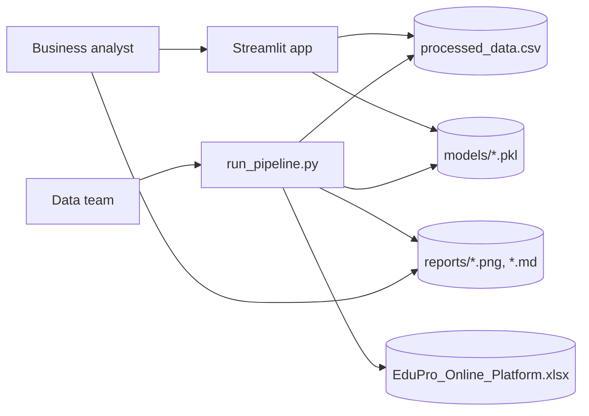
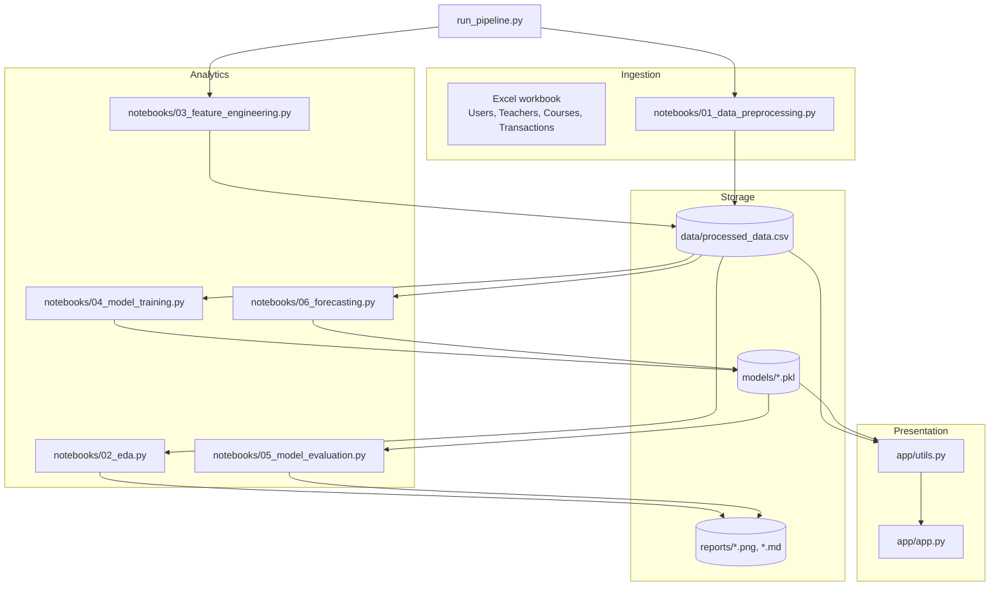
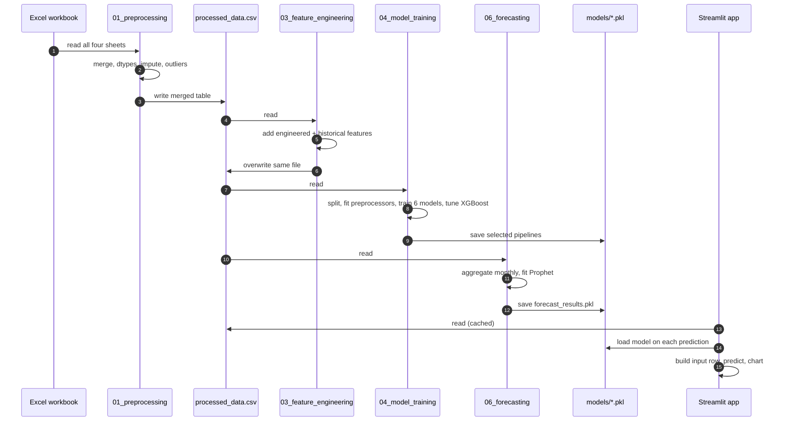
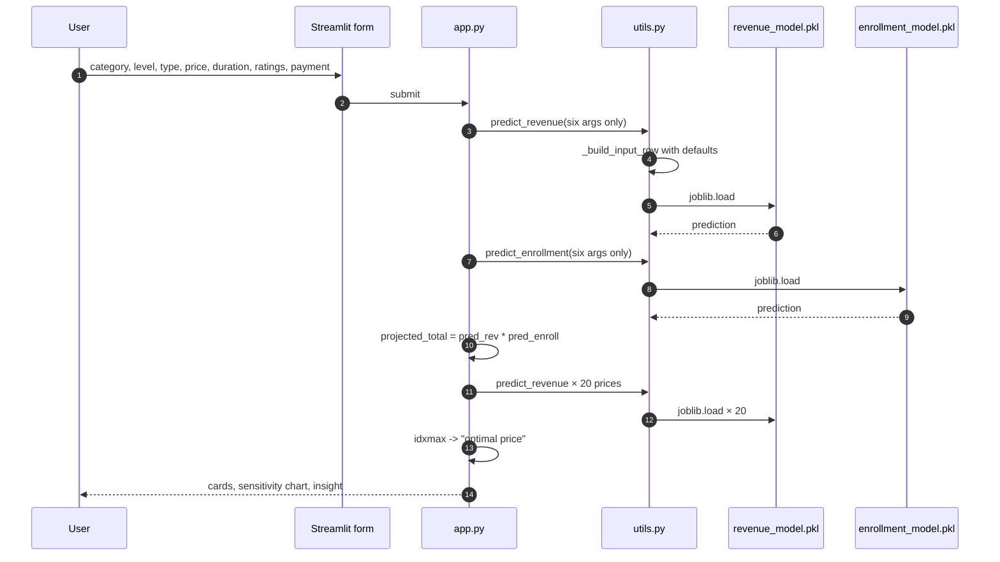
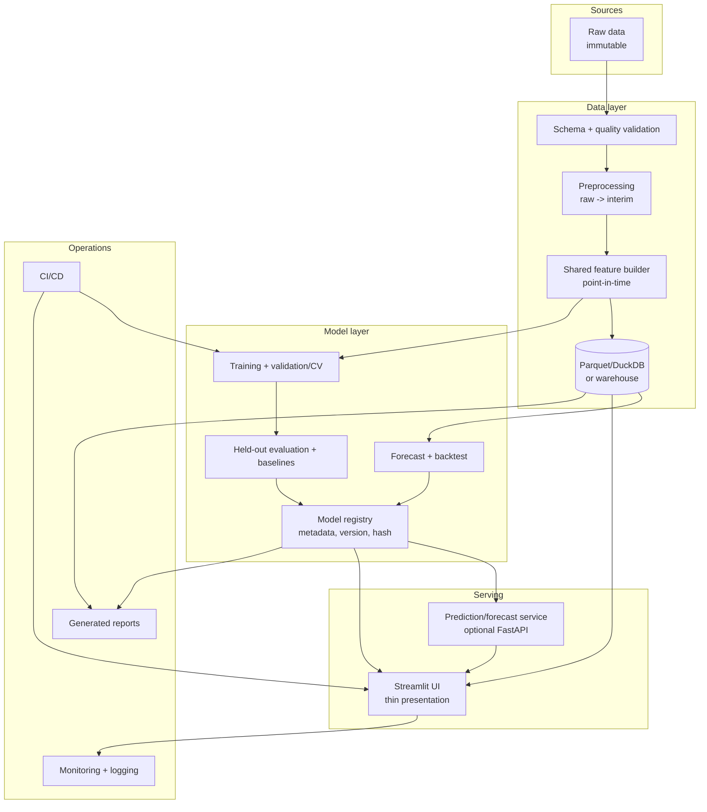
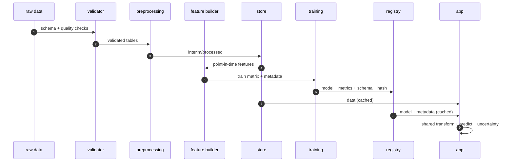
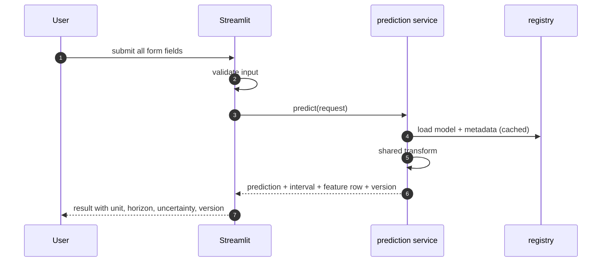

# EDUPRO — Architecture Review

**Companion to:** `audit/EDUPRO_AUDIT_REPORT.md`, `audit/EDUPRO_IMPROVEMENT_ROADMAP.md`, `audit/EDUPRO_TESTING_PLAN.md`
**Audit date:** 2026-10-28
**Scope:** architecture, module boundaries, data/request flows, strengths, weaknesses, and a recommended evolution for EDUPRO.

---

## 1. Executive Summary

EDUPRO is a **batch analytics application with a Streamlit presentation layer**. It has a sensible high-level shape:

1. ingest a four-sheet Excel workbook,
2. merge and clean it into a transaction-level table,
3. engineer features,
4. train regression models,
5. forecast monthly revenue/enrollments,
6. expose outputs through a Streamlit dashboard.

That shape is appropriate for a portfolio/demo and should be preserved. The architecture is not the primary problem; **the contracts between stages are**. There is no shared schema, no shared feature transformation, no model metadata, and no test boundary. As a result:

- training and inference implement the same features twice and disagree (price/duration bins, teacher rating score, expertise match),
- the app depends on the internal step names of saved sklearn pipelines,
- reports are hand-written and already contradict the data,
- model artifacts are opaque and version-sensitive,
- failures are silent or surface as stack traces.

The recommended evolution is an **incremental refactor toward a typed package with a shared feature layer, explicit data contracts, reproducible artifacts, and a thin Streamlit UI**. A database, API, and model registry are optional and should be introduced only when usage justifies them.

---

## 2. Current Architecture

### 2.1 Context diagram



### 2.2 Container/module view



### 2.3 Module responsibilities and dependencies

| Module | Responsibility | Depends on | Produces | Key risk |
|---|---|---|---|---|
| `run_pipeline.py` | Orchestrate six steps via `importlib` | all notebook scripts | console output, artifacts | No error recovery; imports by file path |
| `notebooks/01_data_preprocessing.py` | Load sheets, merge, dtypes, impute, outliers, correlation | Excel | `processed_data.csv` | Assumes exact schema; imputation edge cases |
| `notebooks/03_feature_engineering.py` | Derived course/teacher/time/history features | `processed_data.csv` | same CSV (overwrite) | Not idempotent; look-ahead aggregates |
| `notebooks/02_eda.py` | Static EDA charts | `processed_data.csv` | PNGs | No data contract; assumes columns |
| `notebooks/04_model_training.py` | Build preprocessors, train/evaluate six regressors, tune XGBoost, save | CSV | `enrollment_model.pkl`, `revenue_model.pkl`, `preprocessing_pipeline.pkl` | Duplicated feature lists; test-set selection; target leakage |
| `notebooks/05_model_evaluation.py` | Re-evaluate revenue model, compare models, plots | CSV, models | PNGs, console metrics | Re-uses test split; feature lists duplicated |
| `notebooks/06_forecasting.py` | Monthly aggregation, Prophet/SARIMAX, category trends | CSV | `forecast_results.pkl`, PNGs | No backtest; fallback doesn't save; 12-month history |
| `app/utils.py` | Data load, KPIs, charts, inference, SHAP, forecast load | CSV, models | DataFrames/figures/predictions | Duplicates training transforms; reloads models; broad exceptions |
| `app/app.py` | Five-page Streamlit UI | `utils.py`, CSV, models | UI | Contains business logic; assumes artifacts; hardcoded feature lists |

### 2.4 Data model

Fact table: **Transactions** (10,000 rows).

Dimensions:

- **Users** (3,000): `UserID`, `UserName`, `Age`, `Gender`, `Email`.
- **Teachers** (60): `TeacherID`, `TeacherName`, `Age`, `Gender`, `Expertise`, `YearsOfExperience`, `TeacherRating`.
- **Courses** (60): `CourseID`, `CourseName`, `CourseCategory`, `CourseType`, `CourseLevel`, `CoursePrice`, `CourseDuration`, `CourseRating`.

Relationships:

- Transactions → Courses on `CourseID`.
- Transactions → Teachers on `TeacherID`.
- Transactions → Users on `UserID`.
- Courses have **no teacher assignment**; teachers are attached per transaction. This is the root of the invalid course-level teacher aggregation (F-08).
- There is no primary teacher, no course offering/section, and no time dimension table.

The merged CSV is 44 columns after feature engineering:

- identifiers and raw transaction fields,
- user/teacher demographics,
- engineered course/teacher/time features,
- full-history aggregates and rolling features.

### 2.5 Data flow



### 2.6 Request/inference flow (dashboard prediction)



The sequence exposes three architectural defects:

1. the form fields `course_type`, `course_rating`, `payment_method` never reach `utils.py` (F-03),
2. the model is reloaded per call, 21 times per form submit (F-15),
3. the "optimal price" is computed from a revenue identity without a demand model (F-02).

---

## 3. Architectural Strengths

1. **Clear batch pipeline.** The high-level stages are understandable and match a normal data-science workflow.
2. **Artifact-based decoupling.** The app consumes CSV/model artifacts rather than importing training code. This is a good boundary in principle, even though the contracts are implicit.
3. **Separate analysis from presentation.** `app/utils.py` keeps most chart/inference helpers out of `app.py`.
4. **Model comparison.** Six candidate models are trained and compared, which is a healthy pattern.
5. **Caching at the data boundary.** `@st.cache_data` avoids repeated CSV reads.
6. **Synthetic, self-contained data.** No external services or credentials are required for a demo.
7. **Business-facing UI.** The five pages map to recognizable stakeholder questions.

These strengths should be preserved.

---

## 4. Architectural Weaknesses

### 4.1 Implicit contracts

- **Data contract:** No schema for sheets, processed columns, dtypes, ranges, or categories. A renamed column causes a `KeyError` or a silent model feature drop (`notebooks/04_model_training.py:160-161,192-193`).
- **Feature contract:** Training and inference implement features separately, with different bins and normalization (`notebooks/03_feature_engineering.py:28-115` vs `app/utils.py:201-256`).
- **Artifact contract:** The app assumes `named_steps['preprocessor']`, `named_steps['model']`, and a transformer named `'cat'` (`app/utils.py:296-309`, `app/app.py:356-362`). A pipeline refactor breaks the UI without a type error.
- **Model contract:** No metadata describes the target, horizon, feature list, training window, library versions, or metrics. Pickles are opaque.

### 4.2 Single source of truth violations

- Feature lists appear in at least three files (`notebooks/04_model_training.py:31-42`, `notebooks/05_model_evaluation.py:34-44`, `app/app.py:336-346`).
- Binning/rating/seasonality logic appears in `03_feature_engineering.py` and `utils.py`.
- Paths and constants are repeated.
- Reports contain hand-copied numbers that already disagree with the data.

### 4.3 Overwriting and non-idempotent storage

- Step 03 reads and writes the same CSV (`notebooks/03_feature_engineering.py:16-17`).
- Re-running step 03 produces duplicate `_x/_y` columns when merging historical features.
- All artifacts are overwritten in place; there is no versioned output directory, no atomic write, and no rollback.

### 4.4 Thin separation between analytics and UI

`app/app.py` contains business calculations (top-3 share, free-enrollment insight, growth rate, category KPIs) that are not in a tested service layer (`app/app.py:171-181,302-319,495-499`). This makes them hard to test and reuse.

### 4.5 Inference path is not the training path

The app builds a single row with defaults and a different binning implementation. There is no batch/scoring service and no schema validation at the boundary. This is the most consequential architecture flaw because it produces wrong predictions even when the model is fine.

### 4.6 No operational layer

No authentication, authorization, structured logging, metrics, health checks, model registry, or deployment configuration. The project is a local demo, but the docs call it production-ready.

### 4.7 Resource handling

Models are loaded per request (`app/utils.py:263-267,278-282`), charts/KPIs are recomputed on every rerun, and there is no batch prediction path.

### 4.8 Testing boundary is absent

There is no package structure, so tests cannot import modules cleanly. `run_pipeline.py` and `app/app.py` manipulate `sys.path`, which works for demos but prevents normal test discovery and type checking.

---

## 5. Recommended Changes and Trade-offs

### 5.1 Introduce a typed package

Create a `src/edup/` package with modules for config, schema, data loading/preprocessing, features, models, forecasting, reporting, and the app. Keep thin entry-point scripts (`run_pipeline.py`, `streamlit_app.py`) that call the package.

**Trade-off:** Initial refactor cost; long-term testability and reuse. Recommended.

**Migration:** Extract one module at a time (config → features → data → models → app) with parity tests at each step.

### 5.2 Create one feature transformation layer

A single `build_features(raw_row) -> feature_row` and `build_feature_matrix(df) -> matrix` used by training, evaluation, inference, and tests.

**Trade-off:** Requires a stable feature schema and handling of time-dependent features. Worth it; it directly prevents F-03/F-04.

### 5.3 Add explicit data and artifact contracts

- Pandera/Great Expectations/custom validators for sheets and processed data.
- A JSON schema for model metadata: target, horizon, feature list, dtypes, training window, library versions, data hash, metrics.
- Startup validation in the app.

**Trade-off:** More code and a schema to maintain; eliminates silent drift.

### 5.4 Separate raw/interim/processed/artifacts

```text
data/raw/          # immutable, access-controlled
data/interim/      # merged/cleaned
data/processed/    # model-ready, versioned
artifacts/models/  # versioned models + metadata
artifacts/forecasts/
artifacts/reports/
```

Write atomically (temp + rename) and never overwrite the input of the current step.

**Trade-off:** Slightly more path management; makes reruns safe and auditable.

### 5.5 Make the UI a thin presentation layer

Move calculations into `edup/analytics/` or `edup/reporting/`. The app should:

- validate artifacts at startup,
- load models once,
- call a prediction service,
- render tables/charts,
- show uncertainty and data-quality states.

**Trade-off:** Some upfront extraction; improves testability and consistency.

### 5.6 Add a prediction/forecast service boundary only if needed

If the only consumer is Streamlit, a package-level service is enough. If external systems need predictions, add a small FastAPI service with schema validation, auth, and versioned endpoints.

**Trade-off:** API adds operational cost; avoid until there is a consumer.

### 5.7 Add a columnar serving store when data grows

CSV is fine at 10k rows. For larger data or multiple consumers, use Parquet + DuckDB (simple, local) or a warehouse. Keep the CSV path for development.

**Trade-off:** New dependency and schema management; not needed today.

### 5.8 Add reproducibility and observability

- Pin versions and commit a lockfile.
- Record model metadata and data hashes.
- Add structured logs, metrics, and drift checks when deployed.
- Add CI that runs lint, type checks, tests, and a pipeline smoke test.

**Trade-off:** Operational overhead; required for any shared deployment.

### 5.9 Introduce model/forecast lifecycle

- Version models and forecasts.
- Backtest forecasts and persist metrics.
- Define promotion/rollback criteria.
- Schedule retraining when data refreshes.

**Trade-off:** Start with JSON metadata + directories; adopt MLflow only when the cadence justifies it.

---

## 6. Proposed Target Architecture

### 6.1 Target diagram



### 6.2 Target module layout

```text
edup/
├── pyproject.toml
├── requirements.lock
├── .github/workflows/ci.yml
├── src/edup/
│   ├── config.py              # paths, constants, feature lists
│   ├── schema.py              # data contracts
│   ├── logging.py             # structured logging
│   ├── data/
│   │   ├── load.py
│   │   ├── preprocess.py
│   │   └── quality.py
│   ├── features/
│   │   ├── build.py           # point-in-time
│   │   └── transform.py       # shared train/serve
│   ├── models/
│   │   ├── train.py
│   │   ├── evaluate.py
│   │   ├── predict.py
│   │   └── registry.py
│   ├── forecasting/
│   │   ├── forecast.py
│   │   └── backtest.py
│   ├── analytics/
│   │   ├── kpis.py
│   │   └── category.py
│   ├── reporting/
│   │   └── generate.py
│   └── app/
│       ├── streamlit_app.py
│       └── pages/
├── tests/
├── data/
│   ├── raw/
│   ├── interim/
│   └── processed/
├── artifacts/
│   ├── models/
│   ├── forecasts/
│   └── reports/
└── docs/
```

### 6.3 Target data flow



### 6.4 Target inference flow



---

## 7. Architecture Decision Records (summary)

| ADR | Decision | Rationale | Trade-off |
|---|---|---|---|
| ADR-01 | Keep Streamlit for internal analytics | Fast iteration, low operational cost, fits the demo | Limited auth/layout/perf; revisit for public use |
| ADR-02 | Use a shared feature module | Eliminate train/serve skew and duplicated binning | Upfront refactor |
| ADR-03 | Use schema contracts at every boundary | Fail fast on Excel/schema drift | Maintenance overhead |
| ADR-04 | Keep CSV for development; add Parquet/DuckDB when needed | Avoid premature infrastructure | Two storage paths if not migrated carefully |
| ADR-05 | Start with JSON model metadata; adopt MLflow later | Simple, sufficient for one model pair | Manual comparison until registry is added |
| ADR-06 | Add auth only when deployed beyond localhost | Avoid unnecessary complexity now | Must not expose the app publicly |
| ADR-07 | Use prediction intervals for demand | Trust and honest planning | Requires quantile/conformal methods |

---

## 8. Migration Path

### Step 1 — Freeze and baseline

- Copy current artifacts to a baseline directory.
- Record current metrics, report facts, and app behavior.
- Add syntax/lint checks.

### Step 2 — Extract config and features

- Create `config.py` and `features/`.
- Move binning, rating tiers, seasonality, and input-row construction.
- Add parity tests between training and inference.

### Step 3 — Add schema and data quality

- Define sheet/processed schemas.
- Add validators and a quality report.
- Make the pipeline fail fast.

### Step 4 — Fix targets and evaluation

- Redefine revenue and enrollment targets.
- Add train/validation/test and baselines.
- Persist metrics and metadata.

### Step 5 — Make the app thin and safe

- Validate artifacts at startup.
- Cache models and batch predictions.
- Remove the invalid "optimal price" claim.
- Add AppTest coverage.

### Step 6 — Reproducibility and CI

- Pin dependencies, add lockfile and Python version.
- Add CI for lint/type/tests/pipeline smoke.
- Add model metadata and integrity checks.

### Step 7 — Optional scale/ops

- Parquet/DuckDB, API, registry, retraining, monitoring, auth.
- Only when there is a real consumer or deployment.

---

## 9. Non-Goals and What Not to Change

Do **not**:

- rewrite the whole project in a different framework,
- replace Streamlit with a SPA before the analytics are correct,
- add a database solely to appear "production-ready",
- add deep learning/NLP/reinforcement learning to 10k synthetic rows,
- add microservices for a single-user demo,
- tune hyperparameters further before fixing the targets.

Preserve:

- the batch pipeline concept,
- the artifact-based boundary (with explicit contracts),
- the business-oriented dashboard pages,
- the synthetic/self-contained demo experience.

---

## 10. Risks of the Recommended Architecture

| Risk | Mitigation |
|---|---|
| Refactor breaks the demo | Keep entry points stable; add parity tests before replacing code |
| Schema validation is too strict for evolving data | Version the schema; allow additive columns; fail only on required fields |
| Package extraction delays features | Time-box the extraction; migrate one module at a time |
| Model metadata becomes stale | Generate it in the training step; verify in CI |
| Auth adds friction for a demo | Keep a localhost-only mode; document the boundary |
| Parquet/API/registry add operational load | Defer until there is a concrete consumer or scale need |

---

## 11. Conclusion

EDUPRO's architecture is **fit for a portfolio demo** and does not need a rewrite. It needs **contracts and a shared feature path**. The highest-leverage architectural changes are:

1. one package with one feature builder,
2. schema and artifact contracts,
3. a thin, artifact-validating UI,
4. reproducible, metadata-rich model artifacts,
5. tests and CI around those boundaries.

These changes directly address the confirmed defects (F-01–F-13) and make the later performance, product, and MLOps work safe to pursue. The current batch + Streamlit shape can remain; the evolution is about explicitness, not replacement.
