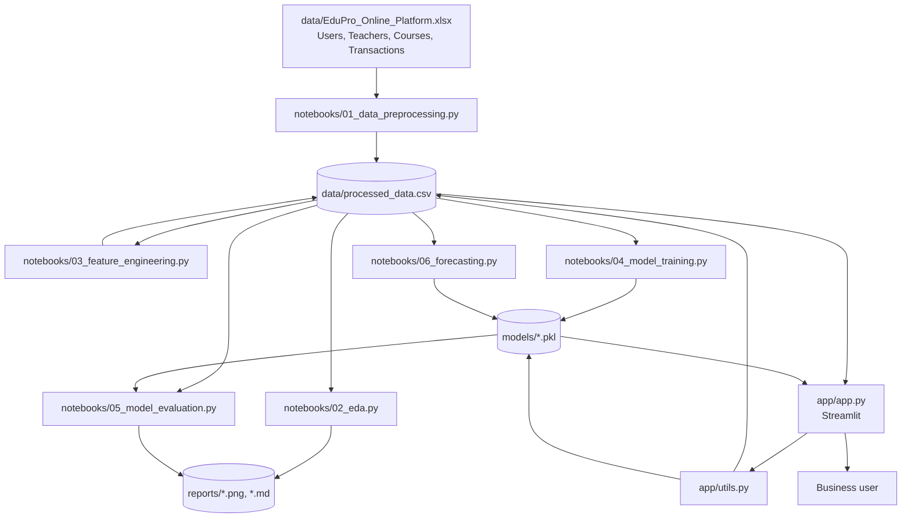
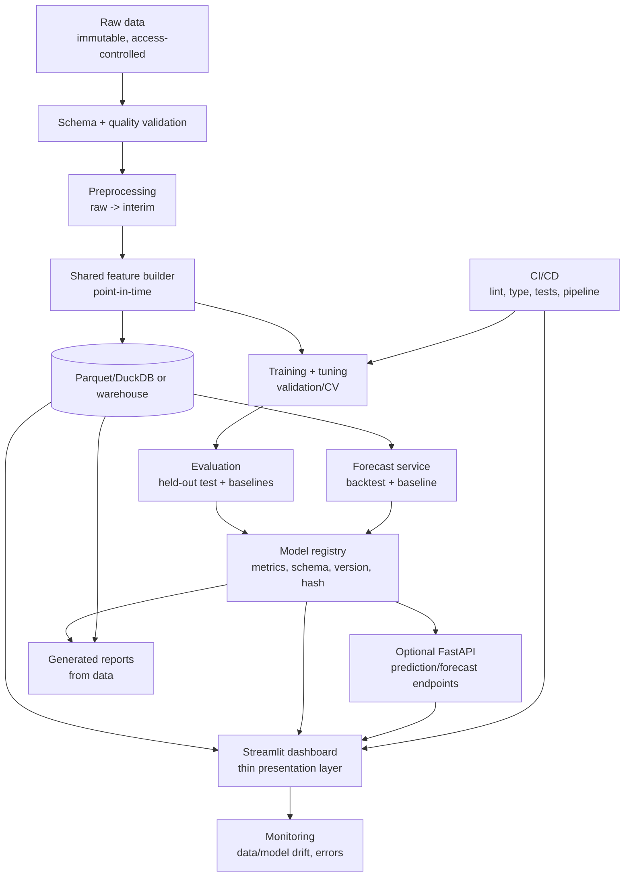

# EDUPRO — Comprehensive Codebase Audit Report

**Project:** EduPro Predictive Analytics Platform
**Audit date:** 2026-10-28
**Auditor role:** senior software architect, full-stack engineer, data scientist, ML engineer, security reviewer, QA engineer, product strategist
**Repository state:** not a Git repository; no commit hash available
**Scope:** all files under `/home/ganesh/projects/EDUPRO`
**Audit mode:** read-only. No project source, data, model, or report file was modified. The only new files are under `audit/`.

---

## 1. Executive Summary

EDUPRO is a batch data-science portfolio project that turns a synthetic four-sheet Excel workbook about an online learning marketplace into:

1. a cleaned transaction-level CSV,
2. a set of regression models for transaction amount and course enrollment count,
3. a Prophet-based six-month revenue/enrollment forecast,
4. matplotlib/seaborn EDA and evaluation charts, and
5. a five-page Streamlit dashboard.

The project is structurally coherent and pleasant to demonstrate, but it is **not production-ready** in the sense claimed by `README.md` and `reports/executive_summary.md`. The central reason is not code style: several of the headline analytics are either tautological, contradicted by the data, or disconnected from the user interface.

### Verified data facts

The checked-in `data/processed_data.csv` is consistent with `data/EduPro_Online_Platform.xlsx` for all 10,000 transactions (amount, course price, and transaction date matched for every row).

| Fact | Verified value |
|---|---|
| Transactions | 10,000 |
| Date range | 2025-01-01 to 2025-12-30 |
| Users / courses / teachers | 3,000 / 60 / 60 |
| Categories | 12 |
| Paid / free rows | 3,597 (35.97%) / 6,403 (64.03%) |
| Total revenue | $911,323.47 |
| Paid rows where `Amount == CoursePrice` | 3,597 of 3,597 |
| Pearson correlation `CoursePrice` vs `Amount` | 1.0 |
| Top 3 revenue categories | Artificial Intelligence ($202,750.67), Business ($181,527.58), Project Management ($169,103.21) — 60.7% combined |
| Machine Learning revenue | $133.38 (0.0146%) |
| Marketing revenue | $0.00 |
| Enrollment count per course | min 140, max 196, mean 166.7, std 12.4 |
| Teachers per course | min 7, max 30, mean 14.8 |
| Teacher rating range | 1.05–4.97 |

### Headline conclusion

There are **no confirmed P0 issues** in the sense of active data loss, exposed secrets, or a compromised production system. There are **nine High/P1 issues**, **fourteen Medium/P2 issues**, and **four Low/P3 issues**.

The five issues that most affect trust and business value are:

1. **F-01** — the revenue model is a price identity, not a revenue predictor.
2. **F-02** — the "optimal price" recommendation always selects the top of the tested range.
3. **F-03 / F-04** — the prediction form ignores three of its inputs and can crash on allowed price values.
4. **F-05 / F-08** — the enrollment "demand" model has almost no signal and aggregates teachers arbitrarily.
5. **F-06** — the README and static reports state facts that contradict the checked-in data (free share, top categories, ML/DS leadership, readiness).

The right response is **not a rewrite**. The pipeline boundaries are sensible. The priority is to repair the target definitions and evaluation protocol, make train-time and serve-time feature logic identical, regenerate reports from data, and add tests/CI so these defects cannot silently return.

---

## 2. Project Overview and Architecture

### 2.1 Purpose and target users

EDUPRO is intended to support an online education marketplace with decisions about:

- expected course enrollment demand,
- transaction-level and course-level revenue,
- six-month revenue and enrollment forecasting,
- pricing and category investment,
- instructor allocation,
- new-course launch validation.

Target users implied by the dashboard and reports: leadership/strategy, marketing, category managers, instructor operations, and finance.

### 2.2 Core user journeys

| Journey | Entry point | Current behavior |
|---|---|---|
| Executive overview | `app/app.py` → Executive Dashboard | KPI cards, monthly revenue, category revenue, top courses, payment methods, static insight text |
| Course demand/revenue prediction | `app/app.py` → Course Demand Prediction | Form → two model predictions → projected revenue → price sensitivity curve |
| Six-month forecast | `app/app.py` → Revenue Forecasting | Historical revenue, Prophet revenue forecast, forecast table, category trends/growth |
| Model explainability | `app/app.py` → Feature Importance Explorer | Feature importances for tree models; optional SHAP for supported models |
| Category deep dive | `app/app.py` → Category Analytics | "Profitability" scatter, teacher scatter, category KPIs, course table |

### 2.3 Technology stack

| Layer | Technology | Evidence |
|---|---|---|
| Data ingestion | pandas, openpyxl, Excel | `requirements.txt:1-14`, `notebooks/01_data_preprocessing.py:26-34` |
| Feature engineering | pandas, NumPy | `notebooks/03_feature_engineering.py` |
| ML | scikit-learn, XGBoost | `notebooks/04_model_training.py:18-25` |
| Explainability | SHAP | `app/utils.py:292-311`, `app/app.py:403-431` |
| Forecasting | Prophet, statsmodels SARIMAX fallback | `notebooks/06_forecasting.py:53-115` |
| Visualization | matplotlib, seaborn, Plotly | `notebooks/02_eda.py`, `app/utils.py:77-196` |
| Dashboard | Streamlit | `app/app.py` |
| Persistence | joblib, CSV, PNG | `models/*.pkl`, `data/processed_data.csv`, `reports/*.png` |
| Runtime observed | Python 3.12 bytecode present (`app/__pycache__/utils.cpython-312.pyc`) | file inventory |

There is no separate backend, REST API, database, authentication layer, external service, container image, CI configuration, or test suite. The Streamlit process is the only runtime service; persistence is CSV/Pickle/PNG on disk.

### 2.4 Architecture diagram (current)



A more detailed architecture review, including strengths, weaknesses, trade-offs, and a proposed target architecture, is in `audit/EDUPRO_ARCHITECTURE_REVIEW.md`.

### 2.5 Entry points and execution flow

- **Full pipeline:** `python run_pipeline.py` (`run_pipeline.py:31-45`). It dynamically imports and calls, in order: preprocessing, feature engineering, EDA, model training, evaluation, forecasting.
- **Individual steps:** `python notebooks/01_data_preprocessing.py`, etc. (`README.md:164-184`).
- **Dashboard:** `streamlit run app/app.py` (`README.md:154-160`).
- **Artifacts consumed by the app:** `data/processed_data.csv` and `models/*.pkl` (`app/utils.py:23-25`).

Important execution details:

1. `01_data_preprocessing.py` merges transactions → courses → teachers → users, writes `processed_data.csv` (`notebooks/01_data_preprocessing.py:37-45,127-140`).
2. `03_feature_engineering.py` reads that CSV and writes **back to the same path** (`notebooks/03_feature_engineering.py:16-17,174`).
3. `04_model_training.py` builds a new `ColumnTransformer` separately for each model, does a random 80/20 split, trains six regressors, tunes XGBoost, and saves the selected pipeline (`notebooks/04_model_training.py:51-60,112-127,151-217`).
4. `05_model_evaluation.py` evaluates the saved revenue model, re-trains all six models on the same split, and writes plots (`notebooks/05_model_evaluation.py:136-193`).
5. `06_forecasting.py` aggregates monthly revenue/enrollments and fits Prophet; on any exception it falls back to SARIMA and does **not** save forecast results (`notebooks/06_forecasting.py:141-180`).
6. `app/app.py` loads the CSV once via `@st.cache_data` and loads models on each prediction call (`app/app.py:89-97`, `app/utils.py:260-287`).

### 2.6 Implementation status

Implemented end-to-end and demonstrable:

- preprocessing, feature engineering, EDA, model training/comparison, evaluation plots, Prophet forecasting, five-page dashboard, static business reports.

Incomplete or unreliable:

- model validity for the stated business questions,
- train/serve feature parity,
- uncertainty communication,
- reproducible dependency/model versioning,
- automated testing and CI,
- production security and observability.

---

## 3. Existing Strengths Worth Preserving

1. **Clear end-to-end narrative.** The README, pipeline scripts, artifacts, and dashboard form a coherent demonstration from raw Excel to a business-facing UI (`README.md:37-116`, `run_pipeline.py:1-50`).
2. **Sensible batch boundaries.** Ingest → processed data → features → models → app is a sound direction; the problem is implementation detail, not the high-level shape.
3. **Deterministic seeds in ML.** `RANDOM_STATE = 42` is used in splits and model constructors (`notebooks/04_model_training.py:27,94-99,168-169,200-201`).
4. **Genuine model comparison.** Six candidate regressors are trained and compared (`notebooks/04_model_training.py:90-127`), which is a good habit to preserve.
5. **Attempt at explainability.** Feature importances and SHAP are wired into the UI (`app/app.py:358-431`), even though the default revenue model cannot use them.
6. **Data caching in the app.** `@st.cache_data` avoids reloading the CSV on every rerun (`app/app.py:89-97`).
7. **Readable dashboard.** The custom CSS, KPI cards, and page separation are clear and business-oriented (`app/app.py:29-84`).
8. **No secrets found.** No API keys, passwords, tokens, or environment variable values were found in source/config files.
9. **Processed data matches raw source.** All 10,000 transactions match the workbook on amount, price, and date.
10. **Synthetic-data declaration.** `README.md:250` states the data is synthetic, which materially reduces the privacy severity of raw names/emails (but does not eliminate the need for handling rules).

---

## 4. Findings by Severity

### 4.0 Critical (P0)

**No confirmed P0 findings.** There is no evidence of active data loss, exposed credentials, destructive behavior, or a compromised production system. The repository is a local analytics project with synthetic data and no deployment configuration.

Two conditional items could become P0/P1 if the deployment context changes:

- **F-18** (raw names and emails) becomes high severity if the data is not synthetic.
- **F-22** (no authentication) becomes high severity if the Streamlit app is exposed publicly.

### 4.1 High severity (P1)

#### F-01 — Revenue model is a price identity, not a revenue prediction

- **Severity:** High · **Confidence:** High · **Priority:** P1 · **Effort:** Large
- **Evidence:**
  - `data/processed_data.csv`: `Amount == CoursePrice` for all 3,597 paid rows; both are 0 for all 6,403 free rows; Pearson correlation is 1.0.
  - `notebooks/04_model_training.py:184-211` trains `y = df['Amount']` on features that include `CoursePrice` and `CourseType`.
  - `models/revenue_model.pkl` contains `LinearRegression` (verified from artifact metadata without unpickling).
  - `README.md:204-205` and `reports/research_paper.md:189-193` celebrate R² = 1.0 as near-deterministic success.
- **Why it matters:** The model is reconstructing an accounting identity (`Amount = CoursePrice` for paid courses, 0 for free). It has no predictive content about future revenue, demand, conversion, or pricing response. Any business conclusion drawn from "revenue prediction" is circular. The dashboard's "Predicted Revenue / Transaction" is effectively the price the user entered.
- **Recommended solution:** Redefine the target around a genuine business question, for example:
  - course-month revenue over a future horizon, with features strictly lagged before the prediction date;
  - expected paid enrollments × price, where demand is modeled separately;
  - paid-vs-free conversion probability, with revenue as a derived quantity.
  Remove contemporaneous `CoursePrice`/`Amount`-derived features from any target that already contains price. Add a leakage assertion that no feature is a deterministic function of the target. Report a mean/seasonal baseline alongside the model.
- **Prerequisites:** Product decision on the prediction horizon and unit of analysis (transaction, course-month, or course). A time-aware data split.

#### F-02 — Pricing sensitivity recommends the maximum tested price

- **Severity:** High · **Confidence:** High · **Priority:** P1 · **Effort:** Medium
- **Evidence:**
  - `app/app.py:229-247` builds a price range and calls `predict_revenue` for each price; it then takes `idxmax()` of predicted revenue and labels it "optimal price".
  - `app/utils.py:260-272` uses the revenue model, whose output is monotonic in `CoursePrice` because of F-01.
  - The enrollment model is not used anywhere in the sensitivity calculation.
- **Why it matters:** The tool will recommend the highest price in the tested range (`price + 100`) almost regardless of course, category, or level. That is not a demand-elasticity analysis. If acted on, it could reduce enrollment and revenue while appearing analytically justified.
- **Recommended solution:** Estimate a demand response, not only a price identity. Use predicted enrollments or paid-conversion probability as a function of price, then compute `expected_revenue(price) = price × predicted_demand(price)`, with a constrained, realistic price range. Show confidence/uncertainty and label the output as a scenario, not an optimum. Validate any recommendation with a controlled experiment. Do not present an "optimal price" until the model can represent demand falling as price rises.
- **Prerequisites:** F-01 and F-05. A target and model that include price response.

#### F-03 — Prediction form ignores three user inputs and does not match training features

- **Severity:** High · **Confidence:** High · **Priority:** P1 · **Effort:** Medium
- **Evidence:**
  - The form collects `course_type`, `course_rating`, and `payment_method` (`app/app.py:194-206`), but the calls at `app/app.py:212-215` pass only category, level, price, duration, experience, and teacher rating.
  - `app/utils.py:260-287` accepts only those six arguments.
  - `_build_input_row` silently defaults `course_type='Paid'`, `course_rating=4.0`, `payment_method='Credit Card'`, `transaction_month=6`, `quarter=2`, `is_weekend=0`, and `ExpertiseCategoryMatch=1` (`app/utils.py:201-204,236-256`).
  - Training uses the real values of all these columns (`notebooks/04_model_training.py:31-42`).
- **Why it matters:** A user who selects "Free", a 2.0 expected rating, or "PayPal" still receives a prediction computed as if the course were paid, rated 4.0, and paid by credit card. This is a direct correctness bug and a train/serve skew. The "Expected Course Rating" slider is decorative.
- **Recommended solution:** Extend the prediction APIs to accept every form field, pass them through, and remove silent defaults except where a documented business default is intentional. Better: build one shared feature-construction function used by training, evaluation, and inference. Add tests that vary each input and assert the output changes where the model learned a relationship. Also expose month/quarter or remove them from the model if future inference cannot know them.
- **Prerequisites:** Shared feature module (see F-21). A decision on whether time features are known at inference.

#### F-04 — Prediction and sensitivity analysis crash at supported price values

- **Severity:** High · **Confidence:** High · **Priority:** P1 · **Effort:** Small
- **Evidence:**
  - `app/app.py:198-199` allows a price up to `500.0`.
  - `app/utils.py:212-215` uses `np.digitize(course_price, [-0.01, 0, 50, 100, 200, 500]) - 1` to index a five-element label list. At `price = 500` (and above), `np.digitize` returns 6, producing index 5 and an `IndexError`.
  - `app/app.py:230` creates sensitivity prices up to `price + 100`, so any selected price of 400 or more produces a tested price of 500 or more and crashes the page after the initial prediction.
- **Why it matters:** A normal user input inside the declared control bounds causes an unhandled exception. The same binning logic also disagrees with training at boundaries (see F-03 and F-10), so even non-crashing prices can produce inconsistent feature values.
- **Recommended solution:** Derive bins and labels in one shared function, validate/clamp prices explicitly, use `pd.cut` with the same `right` setting as training, and handle out-of-range values with a clear message. Add unit tests for 0, 50, 100, 200, 500, and >500. Bound the sensitivity range to the validated domain.
- **Prerequisites:** None; can be fixed immediately.

#### F-05 — Enrollment "demand" model has almost no signal and no uncertainty

- **Severity:** High · **Confidence:** High · **Priority:** P1 · **Effort:** Large
- **Evidence:**
  - `notebooks/04_model_training.py:63-87` aggregates 10,000 transactions into 60 course-level rows and uses `EnrollmentCount` as the target.
  - Verified distribution: min 140, max 196, mean 166.7, std 12.4 (coefficient of variation 7.5%).
  - `reports/research_paper.md:195-202` reports R² near zero (Random Forest −0.003 initially, 0.0002 after tuning); `README.md:207-208` acknowledges low R².
  - The dashboard presents point predictions and a "Predicted Enrollments" KPI without intervals or a warning (`app/app.py:214-227`).
- **Why it matters:** The model cannot distinguish courses; it is close to predicting the mean. The core user journey ("how many learners will enroll?") is therefore not reliably solved, yet the UI communicates a specific number. This is false precision and a product-trust risk.
- **Recommended solution:** Choose a target with actionable variance: monthly/course demand, paid-enrollment counts, or conversion probability. Use temporal and grouped cross-validation, a naive/mean baseline, and prediction intervals (quantile regression, conformal prediction, or bootstrap). Hide or clearly label predictions when the model fails to beat the baseline. Communicate uncertainty in every place a point estimate is shown. Revisit the synthetic data generator if enrollment is intentionally near-uniform.
- **Prerequisites:** F-08 (course/teacher data model) and a product decision on horizon.

#### F-06 — README and static reports contradict the checked-in data and overstate readiness

- **Severity:** High · **Confidence:** High · **Priority:** P1 · **Effort:** Medium
- **Evidence (data-verified):**
  - Free share is **64.03%**, not "50%" (`README.md:218`, `reports/executive_summary.md:39,74`, `reports/research_paper.md:66,235`).
  - Top three revenue categories are **AI, Business, Project Management**, not AI/ML/Data Science (`README.md:217`, `reports/executive_summary.md:39,64`, `reports/research_paper.md:232`).
  - Machine Learning revenue is **$133.38 (0.0146%)** and Marketing is **$0.00**, so recommending ML/DS as top investment areas is directly contradicted by the data.
  - Q1 is not a clear enrollment peak: Q1 2,456 vs Q2 2,555; Q1 revenue is only $237 above Q2 ($231,643 vs $231,406). The "Q1 surge" narrative is not supported by simple aggregates (`reports/executive_summary.md:41-58,80-82`).
  - `README.md:207-208` says Random Forest is the best enrollment model, but the persisted `models/enrollment_model.pkl` is an `XGBRegressor` pipeline (artifact metadata). The docs do not explain the selection change.
  - `reports/executive_summary.md:114-120` presents ROI ranges (8–15%, 5–10%) with no model, baseline, cost data, or code path that produces them.
  - `README.md:9` and `reports/executive_summary.md:128` call the system "production-grade"/"production-ready" despite no tests, auth, CI, monitoring, or reproducibility controls.
  - `reports/research_paper.md:93` says the merged dataset has 22 columns; the checked-in processed CSV has 44 columns after feature engineering. The paper should state clearly that 22 refers to the pre-feature-engineering merge, not the file users open. `reports/research_paper.md:151` says the feature matrix is sparse, but `OneHotEncoder(sparse_output=False)` is used (`notebooks/04_model_training.py:54,165,197`).
- **Why it matters:** These are the documents a stakeholder will read first. They recommend investing in the worst-performing category and misstate the business mix. Forecast and ROI claims appear authoritative but are not traceable to a reproducible run. Trust in the whole platform is damaged when a reader reconciles the report with the data.
- **Recommended solution:** Generate all factual statements and tables from the data at pipeline time (a report renderer with assertions), or add a checked "facts" block produced by code. Update the README to separate "demo status" from "production readiness". Correct category/free-share charts and claims. Qualify forecast statements as model output subject to backtesting. Add a test that recomputes published facts and fails on drift.
- **Prerequisites:** F-20 (data-quality rules) so the facts are stable.

#### F-07 — Model selection uses the test set and final metrics are optimistic

- **Severity:** High · **Confidence:** High · **Priority:** P1 · **Effort:** Medium
- **Evidence:**
  - `train_and_select_best` fits all six models on the training set and picks the best by **test-set R²** (`notebooks/04_model_training.py:112-127`).
  - The tuned XGBoost is also compared to the best baseline on the **same test set** (`notebooks/04_model_training.py:174-178,206-210`).
  - `notebooks/05_model_evaluation.py:147-186` re-splits and evaluates the saved model and all candidates on the same test split.
  - `cross_val_score` is imported but never used (`notebooks/04_model_training.py:18`, `notebooks/05_model_evaluation.py:20`), despite the research paper claiming cross-validation (`reports/research_paper.md:183`).
- **Why it matters:** The test set is used for model selection and then reported as if it were an unbiased estimate. The reported R²/MAE/RMSE are optimistic, especially for the 60-row enrollment problem. This undermines every model comparison in the docs.
- **Recommended solution:** Use train/validation/test or nested cross-validation. Select and tune on validation/CV only; touch the test set once for the final chosen model. Report mean ± std across folds and a baseline. Persist metrics with the model. Add a regression test that asserts the evaluation split is not used for selection.
- **Prerequisites:** A dataset large enough for a meaningful split (transaction-level revenue is; course-level enrollment is marginal).

#### F-08 — Course-level teacher features are aggregated arbitrarily

- **Severity:** High · **Confidence:** High · **Priority:** P1 · **Effort:** Medium
- **Evidence:**
  - Verified: every course is taught by 7–30 different teachers (mean 14.8). The course sheet has no teacher assignment; the teacher is attached to each transaction.
  - `prepare_enrollment_target` uses `TeacherRating=('TeacherRating','first')`, `YearsOfExperience=('YearsOfExperience','first')`, `ExperienceBucket=('ExperienceBucket','first')`, `PaymentMethod=('PaymentMethod','first')`, `TransactionMonth=('TransactionMonth','median')` (`notebooks/04_model_training.py:65-86`).
  - `ExpertiseCategoryMatch` is computed per transaction from the transaction's teacher (`notebooks/03_feature_engineering.py:87-90`) and then reduced with `first`.
- **Why it matters:** "The teacher rating for a course" does not exist in this data model. The first row after an unspecified sort decides the feature, so the same course can receive different teacher features depending on row order. The enrollment target and its features do not describe a stable course configuration, and any "teacher quality drives demand" conclusion is unsupported.
- **Recommended solution:** Define the unit explicitly. Options:
  - model at transaction level with the assigned teacher,
  - define a primary instructor per course (and store it in the course dimension),
  - aggregate teacher quality as a weighted mean/exposure-adjusted measure and document the weighting.
  Also remove transaction-level noise features (`PaymentMethod 'first'`, month median) from a course-level target or replace them with meaningful aggregates.
- **Prerequisites:** Product/data-model decision; possibly changes to the synthetic data generator.

#### F-09 — Feature Importance Explorer is broken for the default model

- **Severity:** High · **Confidence:** High · **Priority:** P1 · **Effort:** Medium
- **Evidence:**
  - The saved revenue model is `LinearRegression` (`models/revenue_model.pkl` artifact metadata).
  - The page defaults to "Revenue Prediction" (`app/app.py:351`), then only renders importances if `hasattr(final_model, 'feature_importances_')` (`app/app.py:358`). `LinearRegression` has none, so the page shows a warning (`app/app.py:432-433`) and no SHAP section (SHAP is nested inside the same branch).
  - `utils.compute_shap_values` always uses `shap.TreeExplainer(final_model)` (`app/utils.py:309`), which is not valid for a linear model.
  - README and the research paper claim SHAP as a delivered capability (`README.md:113,194`, `reports/research_paper.md:9`, `reports/executive_summary.md:78,99`).
- **Why it matters:** A headline dashboard page fails on its default selection. Users cannot explain the revenue model, which is the model the reports use to justify pricing and instructor recommendations.
- **Recommended solution:** Make explainability model-aware: use `LinearExplainer`/`PermutationExplainer` for linear models, `TreeExplainer` for tree ensembles, or use model-agnostic permutation importance everywhere. Handle the no-importance case with a useful message and a fallback. Add a smoke test that opens each page with each artifact.
- **Prerequisites:** F-01 (the revenue model should be replaced/reframed anyway).

### 4.2 Medium severity (P2)

#### F-10 — Historical and rolling features leak future information if used

- **Severity:** Medium · **Confidence:** High · **Priority:** P2 · **Effort:** Medium
- **Evidence:** `notebooks/03_feature_engineering.py:120-154` computes `EnrollmentCount`, `TotalRevenue`, `AverageRevenue`, `RevenuePerEnrollment`, `MonthlyRevenue`, `RollingRevenueAverage`, and `RevenueGrowthRate` over the entire dataset, including months after each transaction. The README and research paper present these as model features (`README.md:80-84`, `reports/research_paper.md:130-138`). They are not currently in `NUMERIC_FEATURES`/`CATEGORICAL_FEATURES` (`notebooks/04_model_training.py:31-42`).
- **Why it matters:** If anyone adds these columns to the feature list, the model will see the future, producing excellent offline metrics and useless live predictions. The documentation already implies they are used, so the risk of accidental inclusion is real.
- **Recommended solution:** Compute point-in-time features with an explicit cutoff (expanding window or lag-only), or mark these columns as analysis-only and keep them out of the model artifact. Add a leakage test that verifies every feature timestamp precedes the target timestamp.
- **Prerequisites:** A defined prediction timestamp and horizon.

#### F-11 — Dashboard fails ungracefully when data or models are missing

- **Severity:** Medium · **Confidence:** High · **Priority:** P2 · **Effort:** Small
- **Evidence:** `app/utils.py:44-47` reads `processed_data.csv` with no existence check; `app/app.py:89-91` calls it at page load. `app/app.py:348-349` checks only one model path; other pages assume columns and artifact structure. If the pipeline has not run, the app raises a `FileNotFoundError`/`KeyError` traceback instead of an onboarding message.
- **Why it matters:** The README instructs users to run the pipeline first, but the dashboard is a separate entry point. A missing file is an expected first-run condition, not an exceptional crash. Poor first-run reliability undermines the "production-ready" claim.
- **Recommended solution:** Add a small `ensure_artifacts()` check at startup, catch missing files, and show a friendly `st.error` with the exact command to run. Validate required columns and model keys. Add a degraded mode that shows available pages only.
- **Prerequisites:** None.

#### F-12 — Feature engineering is not idempotent and can duplicate columns

- **Severity:** Medium · **Confidence:** High · **Priority:** P2 · **Effort:** Medium
- **Evidence:** `notebooks/03_feature_engineering.py:16-17` uses the same path for input and output (`processed_data.csv`). `add_historical_features` and `add_rolling_revenue` merge DataFrames containing columns that already exist in the input (`notebooks/03_feature_engineering.py:120-154`). Re-running step 03 without first re-running step 01 causes pandas to create `EnrollmentCount_x/_y`, `MonthlyRevenue_x/_y`, etc., and the schema drifts. The README advertises running step 03 independently (`README.md:173-174`).
- **Why it matters:** A documented workflow produces a different schema depending on run history. Downstream code that references exact column names may silently use the wrong suffix or fail. It also makes "reproducible pipeline" false.
- **Recommended solution:** Separate raw/interim/processed paths. Drop or recompute existing engineered columns at the start of step 03. Write to a temporary file and atomically replace. Add an idempotency test: run the step twice and assert identical schema and row values.
- **Prerequisites:** None; coordinate with F-17.

#### F-13 — No schema or data-contract validation

- **Severity:** Medium · **Confidence:** High · **Priority:** P2 · **Effort:** Medium
- **Evidence:** `notebooks/01_data_preprocessing.py:26-45` assumes exact sheet names and columns; `merge_datasets` renames `Age_x/Age_y`/`Gender_x/Gender_y` unconditionally (`notebooks/01_data_preprocessing.py:42-43`). If a sheet or column is renamed, or if teachers lack Age/Gender, the code raises a `KeyError` or silently skips the rename and later references `UserAge`/`UserGender`. Model training assumes 11 numeric and 8 categorical columns; missing columns are silently dropped (`notebooks/04_model_training.py:160-161,192-193`) and the app hardcodes the full lists (`app/app.py:336-346`).
- **Why it matters:** The integration boundary is an Excel file that a business user can edit. Silent column drops change the model without an error; a renamed column causes a stack trace. Neither is acceptable for a pipeline that claims reproducibility.
- **Recommended solution:** Add a schema contract (Pandera, Great Expectations, or a small custom validator) for each sheet and for the processed dataset: required columns, dtypes, ranges, unique keys, allowed categories, nullability. Fail early with a readable error. Include the schema version in model metadata.
- **Prerequisites:** F-17 (versioned artifacts) ideally.

#### F-14 — Broad exception handling and global warning suppression hide failures

- **Severity:** Medium · **Confidence:** High · **Priority:** P2 · **Effort:** Small/Medium
- **Evidence:**
  - `warnings.filterwarnings('ignore')` appears in `app/app.py:12`, `app/utils.py:12`, and all notebook scripts (e.g., `notebooks/01_data_preprocessing.py:19`, `notebooks/04_model_training.py:16`).
  - `notebooks/06_forecasting.py:149-180` catches any exception from Prophet, prints a message, runs ARIMA, and returns `(None, None)` without saving `forecast_results.pkl`; the dashboard then says the forecast was not generated (`app/app.py:288-289`).
  - Broad `except Exception` blocks also appear in `notebooks/05_model_evaluation.py:84`, `app/app.py:363,430`, and `app/utils.py:303`.
- **Why it matters:** A data-shape bug, a version incompatibility, and a missing optional dependency all collapse into the same "Prophet unavailable" path. The user sees a missing forecast, not the root cause. Suppressing all warnings hides deprecations and data-quality warnings that will become failures on the next dependency upgrade.
- **Recommended solution:** Catch specific exceptions (e.g., `ImportError` for an optional dependency), log the full traceback with context, persist a status object (`source: prophet|arima`, `error`, `generated_at`), and display it. Stop filtering all warnings globally; filter only known, documented warnings at the call site.
- **Prerequisites:** Logging setup (F-23).

#### F-15 — Model reload and repeated computation on every prediction

- **Severity:** Medium · **Confidence:** High · **Priority:** P2 · **Effort:** Small
- **Evidence:** `utils.predict_revenue` and `utils.predict_enrollment` call `joblib.load` on every invocation (`app/utils.py:263-267,278-282`). The pricing loop calls `predict_revenue` 20 times (`app/app.py:230-234`), so a single form submission deserializes the revenue model 21 times. KPI and chart computations are also uncached (`app/app.py:140-181`), even though only the raw data is cached.
- **Why it matters:** Deserialization is unnecessary I/O and CPU on every interaction. At 10k rows the absolute latency may still be acceptable, but the pattern does not scale and makes the UI feel sluggish on slower hosts. Streamlit reruns the entire script on each widget interaction.
- **Recommended solution:** Load models once with `@st.cache_resource` (or an application-level singleton) and reuse them. Batch the sensitivity predictions into a single `model.predict` call. Cache chart/KPI outputs keyed by the data hash. Measure page latency before/after.
- **Prerequisites:** None.

#### F-16 — Forecast lacks backtesting, baselines, and production lifecycle

- **Severity:** Medium · **Confidence:** High · **Priority:** P2 · **Effort:** Medium/Large
- **Evidence:** `notebooks/06_forecasting.py:53-86` fits Prophet with yearly seasonality on 12 monthly points (`notebooks/06_forecasting.py:29-34`); there is no holdout, rolling-origin backtest, error metric, or naive/seasonal-naive baseline. The exception path (`notebooks/06_forecasting.py:173-180`) does not save results. The enrollment forecast is computed and saved (`notebooks/06_forecasting.py:154-169`) but the dashboard only displays the revenue forecast (`app/app.py:261-289`). Category forecasts are plotted but not persisted.
- **Why it matters:** One year of monthly data is a very weak basis for estimating yearly seasonality. The reported six-month forecast is presented with confidence intervals but without any measured accuracy. The dashboard promises enrollment projections yet never shows them. Users cannot tell whether the model beats a simple baseline.
- **Recommended solution:** Use rolling-origin backtesting with a seasonal-naive baseline; report MAE/MAPE per horizon. Require a minimum history before enabling yearly seasonality (or set it to `False` with 12 points). Persist forecast metadata (training window, horizon, metrics, library version). Either surface the enrollment forecast or remove the claim. Add a backtest chart.
- **Prerequisites:** More history for credible seasonality; a data refresh process.

#### F-17 — Dependency, model, and environment reproducibility are not controlled

- **Severity:** Medium · **Confidence:** High · **Priority:** P2 · **Effort:** Medium
- **Evidence:** `requirements.txt:1-14` uses only lower bounds (`>=`) and no lockfile; `app/requirements.txt:1-13` is a near-duplicate that omits `nbformat` but adds nothing else. No Python version file, `pyproject.toml`, lockfile, or container. Model artifacts are opaque pickles with no recorded sklearn/XGBoost version, training data hash, metrics, or schema (`models/*.pkl`). `_sklearn_version` metadata is embedded by joblib but not surfaced. `models/preprocessing_pipeline.pkl` is saved (`notebooks/04_model_training.py:213-215`) but never used.
- **Why it matters:** Pickles are tightly coupled to library versions. An unpinned `scikit-learn`, `xgboost`, `shap`, or `prophet` update can make the artifacts unloadable or change predictions. A new environment may install a combination that never existed when the models were trained. There is no way to know which data produced the checked-in models.
- **Recommended solution:** Pin exact versions and commit a lockfile; declare a Python version; add a `pyproject.toml`. Save a `model_metadata.json` next to each artifact with training date, data hash, row count, feature list, library versions, metrics, and Git commit. Add a CI environment that reproduces training. Consider a model registry (MLflow) only when the project outgrows JSON metadata.
- **Prerequisites:** F-23 (CI).

#### F-18 — Raw workbook contains user names and emails

- **Severity:** Medium (High if data is not synthetic) · **Confidence:** High for presence, Medium for impact · **Priority:** P2 now; P1 if real · **Effort:** Small
- **Evidence:** The `Users` sheet in `data/EduPro_Online_Platform.xlsx` contains `UserName` and `Email`; all 3,000 data rows have a unique email. The processed CSV drops email but still contains `TeacherName`, `UserAge`, `UserGender`, `TeacherAge`, and `TeacherGender`. `README.md:250` states the data is synthetic.
- **Why it matters:** If the synthetic claim is wrong or the workbook is replaced with real data, the repository ships direct identifiers and quasi-identifiers. Even with synthetic names, `TeacherName` plus age/gender can look like real personal data to a reviewer. There is no data-handling note, anonymization step, or `.gitignore` for raw data.
- **Recommended solution:** Keep raw data out of version control, publish only an anonymized/synthetic sample, and add a data classification note. Drop or hash names in the processed data unless the UI needs them. If real data is ever used, add consent, retention, and access-control review.
- **Prerequisites:** Confirmation of the synthetic-data claim; a data governance decision.

#### F-19 — "Profitability" and "YTD growth" labels overstate what is computed

- **Severity:** Medium · **Confidence:** High · **Priority:** P2 · **Effort:** Small
- **Evidence:** `chart_category_profitability` computes `RevenuePerEnrollment = Revenue / Enrollments` and plots it against average price (`app/utils.py:177-196`); there is no cost, margin, or profit input. The page calls this "Category Profitability Matrix" (`app/app.py:447-448`). The growth chart groups by month, then compares the first and last observed month but titles it "YTD Revenue Growth Rate" (`app/app.py:302-319`).
- **Why it matters:** "Profitability" implies costs and margins; the chart shows revenue efficiency. A manager could use it to justify investment or pricing decisions on a false premise. "YTD" is factually wrong when the comparison spans the full year or arbitrary first/last months.
- **Recommended solution:** Rename to "Revenue per Enrollment" or "Revenue Efficiency" unless a cost model exists. Compute growth over an explicit period and label it (e.g., "Jan–Dec 2025 growth") or use a proper period-over-period calculation with full months only.
- **Prerequisites:** None.

#### F-20 — Data anomalies are not validated or surfaced

- **Severity:** Medium · **Confidence:** High · **Priority:** P2 · **Effort:** Medium
- **Evidence:**
  - Course `CR00028` ("Deep Learning", Machine Learning) is `Paid` at **$0.78**; its 171 paid transactions generate $133.38, which drives the entire Machine Learning category's revenue.
  - All five Marketing courses are free; the category has 806 enrollments and $0 revenue.
  - Two course names are duplicated across different CourseIDs ("Deep Learning" and "Natural Language Processing").
  - The pipeline prints outlier counts but does not validate or flag anomalies (`notebooks/01_data_preprocessing.py:88-107`).
- **Why it matters:** These anomalies distort category rankings and the reports. A $0.78 paid course and a fully free category are likely data-generation artifacts, not business facts. Without validation, they flow into models and executive recommendations.
- **Recommended solution:** Add data-quality rules: paid courses must have a plausible minimum price; paid/free flags must align with amount; category/course names should be unique or explicitly versioned. Quarantine or flag anomalies in an audit table. Document known synthetic artifacts. Revisit the generator if the dataset is meant to be realistic.
- **Prerequisites:** F-13.

#### F-21 — Duplication, dead code, and inconsistent documentation increase drift risk

- **Severity:** Medium · **Confidence:** High · **Priority:** P2 · **Effort:** Medium
- **Evidence:**
  - Feature lists are duplicated in `notebooks/04_model_training.py:31-42`, `notebooks/05_model_evaluation.py:34-44`, and `app/app.py:336-346`; binning/rating/seasonality logic is duplicated in `notebooks/03_feature_engineering.py:28-115` and `app/utils.py:209-234`.
  - `get_kpis(df_hash)` is defined but never called and ignores its argument (`app/app.py:94-97`).
  - `chart_course_level_comparison` is defined but never used (`app/utils.py:142-157`).
  - `top10` is computed but unused in `chart_teacher_performance` (`app/utils.py:166`).
  - `PRICE_BANDS`, `DURATION_BUCKETS`, `RATING_TIERS`, `EXPERIENCE_BUCKETS`, and `SEASONALITY_LABELS` are unused constants (`app/utils.py:35-39`).
  - `models/preprocessing_pipeline.pkl` is written but never read.
  - `reports/research_paper.md:93` describes a 22-column merged dataset (the pre-feature-engineering stage) while the checked-in processed artifact has 44 columns; `reports/research_paper.md:151` describes a sparse matrix while the encoder is dense.
- **Why it matters:** Duplicated feature logic is exactly how F-03/F-04 happened. Every schema or bin change must be made in several places, and the docs already disagree with the artifacts. This is the highest-leverage maintainability problem after the target definitions.
- **Recommended solution:** Create one shared module (e.g., `src/edup/features.py` + `src/edup/config.py`) used by training, evaluation, inference, and the app. Delete unused functions/constants/artifacts. Generate the feature list from the model artifact or schema. Correct the documentation. Add tests that compare training and inference feature outputs for the same input.
- **Prerequisites:** F-03; ideally before F-17.

#### F-22 — No authentication or access control if the dashboard is exposed

- **Severity:** Medium (High if public) · **Confidence:** High for absence, Medium for exposure · **Priority:** P2 now; P1 if public · **Effort:** Medium
- **Evidence:** `app/app.py` has no login, session, role, or authorization logic. Streamlit serves the app with its defaults; there is no CORS, TLS, reverse-proxy, or secrets configuration in the repository. No deployment file exists.
- **Why it matters:** If hosted beyond localhost, anyone with the URL can view revenue data, teacher names, demographics, and model behavior. There is no audit trail of who accessed or changed anything.
- **Recommended solution:** If the app remains an internal demo, document that it must run on localhost or a trusted network. If it is deployed, put it behind an authenticated reverse proxy or Streamlit OAuth/SSO, add role-based page access, enforce TLS, and keep secrets in a managed store. Add a deployment checklist.
- **Prerequisites:** A deployment decision.

#### F-23 — No automated tests, CI, or observability

- **Severity:** Medium · **Confidence:** High · **Priority:** P2 · **Effort:** Large
- **Evidence:** No `tests/`, `test_*.py`, `conftest.py`, `pytest.ini`, `.github/workflows`, `Dockerfile`, or CI config exists. The only automated check available during this audit was an AST syntax parse of the nine Python files (all parsed). There is no logging framework; the pipeline uses `print`, and the app has no telemetry, error tracking, or model/data drift monitoring.
- **Why it matters:** Every confirmed bug in this report (price crash, ignored inputs, train/serve skew, report/data drift) is the kind of defect a small unit/integration suite would catch. Without CI, regressions are invisible until a demo fails. Without observability, a deployed model can degrade silently.
- **Recommended solution:** Add pytest unit/integration tests, a Streamlit AppTest smoke suite, and a CI workflow that runs lint, type checks, tests, and an end-to-end pipeline on a small fixture. Add structured logging and basic metrics. See `audit/EDUPRO_TESTING_PLAN.md`.
- **Prerequisites:** Dependency pinning (F-17) and shared modules (F-21).

### 4.3 Low severity (P3)

#### F-24 — Unsafe pickle deserialization of local model artifacts

- **Severity:** Low · **Confidence:** High · **Priority:** P3 · **Effort:** Medium
- **Evidence:** `app/utils.py:267,282,321` and `app/app.py:355` call `joblib.load` on files under `models/`. Pickle/joblib can execute arbitrary code during deserialization. There is no checksum, signature, or trusted-artifact registry.
- **Why it matters:** The current threat model is local and the artifacts are project-owned, so risk is low. If a model file can be replaced by an untrusted party (shared repo, CI artifact, upload path), arbitrary code execution follows.
- **Recommended solution:** Treat model artifacts as build outputs, verify checksums/signatures, restrict write access, and load only from a trusted registry. Consider ONNX or a serialization format without executable semantics for serving. Add an integrity check at startup.
- **Prerequisites:** F-17.

#### F-25 — Potential XSS through `unsafe_allow_html` with data-derived strings

- **Severity:** Low · **Confidence:** Medium · **Priority:** P3 · **Effort:** Small
- **Evidence:** `app/app.py:102-107,177,388-395,498` inject values derived from the dataset (category names, course names, feature names) into HTML with `unsafe_allow_html=True`.
- **Why it matters:** With the current synthetic workbook, the authors control the strings, so risk is low. If course names or categories become user-generated, stored HTML/script could execute in an analyst's browser.
- **Recommended solution:** Avoid raw HTML for data-derived values; use Streamlit native components (`st.metric`, `st.info`, `st.markdown` without `unsafe_allow_html`) or escape values with `html.escape`.
- **Prerequisites:** None.

#### F-26 — Repository hygiene and packaging gaps

- **Severity:** Low · **Confidence:** High · **Priority:** P3 · **Effort:** Small
- **Evidence:** 37 Windows `*:Zone.Identifier` files are present (harmless metadata, but clutter); `app/__pycache__/utils.cpython-312.pyc` is present in the tree; there is no `.gitignore`, `LICENSE` file, package metadata, or `.editorconfig`. Data and model binaries are mixed with source.
- **Why it matters:** The repository is harder to clone, review, and package; bytecode and OS metadata create noise and can leak local paths. The README states a license but no license file exists.
- **Recommended solution:** Add `.gitignore` (bytecode, caches, raw data if sensitive, model binaries if regenerable), remove Zone.Identifier files, add a LICENSE, and separate source/data/artifacts. Consider DVC or Git LFS for data/model versioning.
- **Prerequisites:** None.

#### F-27 — UI and dependency deprecation risks

- **Severity:** Low · **Confidence:** Medium · **Priority:** P3 · **Effort:** Small/Medium
- **Evidence:** `use_container_width=True` is used throughout `app/app.py` (e.g., lines 158–169, 243, 259, 281, 287, 300, 319, 380, 383, 428, 448, 451, 472, 482, 493); newer Streamlit releases deprecate it in favor of `width='stretch'`. `st.set_page_config(page_icon=None)` (line 22) could not be executed in this environment. CSS targets `div[data-testid="stSidebarNav"]` (line 82), which is a brittle internal test id. `mean_squared_error` is used without `squared=False` and then square-rooted (`notebooks/04_model_training.py:107`, `notebooks/05_model_evaluation.py:153,181`); the `squared` parameter is deprecated in recent scikit-learn versions.
- **Why it matters:** With lower-bound-only dependencies, a fresh install can pull versions where these calls warn or break. The audit could not execute the app to confirm current behavior.
- **Recommended solution:** Pin and test a supported dependency set; migrate to `width='stretch'`; avoid private CSS selectors; replace deprecated metrics with `root_mean_squared_error` or explicit `squared=False` at the pinned version. Add a dashboard smoke test.
- **Prerequisites:** F-17 and F-23.

---

## 5. Code Quality and Maintainability Findings

### 5.1 Organization and separation of concerns

Strengths:

- Pipeline steps are separated into numbered scripts with clear responsibilities.
- The app separates data/model helpers (`app/utils.py`) from presentation (`app/app.py`).
- Model training and evaluation are distinct steps.

Weaknesses:

- The "notebooks" are plain `.py` scripts, not notebooks; the naming is misleading and there is no notebook execution/format support.
- No package boundary. Modules are loaded via `importlib.util` and `sys.path` manipulation (`run_pipeline.py:18-20,34-38`, `app/app.py:14-16`), which is fragile and prevents normal imports/test discovery.
- Feature definitions, binning rules, and path constants are duplicated (F-21).
- Data, code, model binaries, and generated reports all live in one tree with no `raw/interim/processed/artifacts` separation.
- The dashboard contains business logic (top-3 calculation, growth-rate calculation, KPIs) that belongs in a tested service/helper layer (`app/app.py:171-181,302-319`).

### 5.2 Modularity, cohesion, coupling

- Cohesion is high within each script, but coupling is via implicit file paths and exact column names. There are no interfaces or schema contracts.
- The app depends on the exact internal structure of saved sklearn pipelines (`named_steps['preprocessor']`, `named_steps['model']`, transformer name `'cat'`) (`app/utils.py:296-309`, `app/app.py:356-362`). Any pipeline refactor breaks the UI.
- The training script mutates and reuses a single `preprocessor` object across multiple pipelines (`notebooks/04_model_training.py:117-127,195-215`). Pipeline fitting happens in place; the object is shared and later refit for the standalone artifact. This works only because every model uses the same `X_train`; it is fragile and should be replaced with per-pipeline construction or `clone`.

### 5.3 Naming, readability, type safety, documentation

- Names are generally clear (`predict_revenue`, `prepare_monthly_revenue`).
- Docstrings are inconsistent: some functions have helpful summaries, many do not; public app helpers lack parameter/return documentation.
- No type hints anywhere; no mypy/pyright configuration.
- Magic numbers and thresholds are embedded in functions (price bins, rating tiers, experience buckets, test size, random state).
- `warnings.filterwarnings('ignore')` hides type/deprecation/data warnings.
- There is no data dictionary in code or a machine-readable schema.

### 5.4 Error handling, logging, configuration, validation

- Errors are mostly allowed to propagate (`pd.read_excel`, `joblib.load`) or are caught too broadly (F-14).
- No structured logging, log levels, or correlation IDs. Pipeline progress is `print` only.
- Configuration is hardcoded paths and constants; no environment-specific config or `.env` handling.
- No input validation beyond Streamlit widget bounds; F-04 shows the bounds do not protect the model.

### 5.5 Hardcoded values, dead code, complexity, technical debt

- Hardcoded: workbook sheet names, category/level/payment lists, feature lists, price bins, paths, forecast periods, date cutoffs.
- Dead/unused: `get_kpis`, `chart_course_level_comparison`, `top10`, unused constants, `preprocessing_pipeline.pkl`, `cross_val_score` imports, `nbformat` dependency.
- Complexity is modest; the main technical debt is duplicated logic and unvalidated data contracts.

### 5.6 Dependency management and compatibility

- Lower-bound-only requirements (F-17).
- Duplicate/inconsistent requirement files.
- Heavy dependency surface for a demo: Prophet, statsmodels, XGBoost, SHAP, Plotly, matplotlib, seaborn, Streamlit.
- No lockfile, no vulnerability scan, no license audit.
- `mean_squared_error` deprecation risk (F-27).

### 5.7 Scalability and fit for purpose

The architecture fits a 10k-row portfolio demo. It does not fit a production marketplace:

- batch CSV and pickle artifacts,
- single-process Streamlit,
- no database or API,
- no incremental/streaming ingestion,
- no multi-user access control,
- no model registry/monitoring.

The recommended evolution is incremental (see the architecture review), not a rewrite.

---

## 6. Bugs and Functional Risks

This section consolidates confirmed and likely bugs. Detailed evidence is in the finding sections above.

### 6.1 Confirmed bugs

| Bug | Evidence | Impact | Finding |
|---|---|---|---|
| Price `500` raises `IndexError`; sensitivity range >=400 crashes | `app/utils.py:212-215`, `app/app.py:198-199,230` | Page crash during normal use | F-04 |
| `course_type`, `course_rating`, `payment_method` ignored | `app/app.py:194-206,212-215`, `app/utils.py:260-287` | Predictions do not reflect user choices | F-03 |
| PriceBand/DurationBucket boundary values differ between training and inference | `notebooks/03_feature_engineering.py:28-43` vs `app/utils.py:209-219` | Wrong feature values at 0/50/100/200/500 and duration boundaries | F-03/F-04 |
| `TeacherRatingScore` uses dataset min/max in training (1.05–4.97) but fixed 1–5 at inference | `notebooks/03_feature_engineering.py:79-84`, `app/utils.py:209-210` | Small but systematic train/serve skew | F-03 |
| `ExpertiseCategoryMatch` always 1 at inference, but only 41.1% of training rows are 1 | `app/utils.py:244`, `notebooks/03_feature_engineering.py:87-90` | Substantial train/serve skew | F-03 |
| Revenue model is an identity, not a predictor | data + `notebooks/04_model_training.py:184-211` | Core analytics invalid | F-01 |
| "Optimal price" always selects the max tested price | `app/app.py:229-247` | Misleading pricing recommendation | F-02 |
| Default Feature Importance page cannot render the revenue model | model artifact + `app/app.py:351-358,432-433` | Broken headline feature | F-09 |
| Re-running feature engineering duplicates columns | `notebooks/03_feature_engineering.py:16-17,120-154` | Schema drift, possible wrong columns | F-12 |
| Reports state facts contradicted by data | `README.md:217-218`, `reports/executive_summary.md:39,74`, `reports/research_paper.md:232,235` | Wrong business decisions/trust loss | F-06 |
| ARIMA fallback does not save forecast results | `notebooks/06_forecasting.py:173-180` | Dashboard shows no forecast after a "successful" fallback | F-14/F-16 |

### 6.2 Likely bugs / risky assumptions

| Issue | Evidence | Why likely | Finding |
|---|---|---|---|
| Teacher features for a course are arbitrary | 7–30 teachers/course; `first` aggregation | Row-order dependent; no stable course-teacher mapping | F-08 |
| Historical/rolling features would leak if used | `notebooks/03_feature_engineering.py:120-154` | Computed on full history, including future months | F-10 |
| Revenue model selection is optimistic | test-set selection `notebooks/04_model_training.py:112-127,174-178` | Test set used twice | F-07 |
| Forecast seasonality is weakly identified | 12 monthly points, yearly seasonality `notebooks/06_forecasting.py:57-63` | Less than two annual cycles | F-16 |
| Missing-data imputation can fail silently | `notebooks/01_data_preprocessing.py:56-73` | `mode()[0]`/median can still be NaN for all-null columns | F-13 |
| `fix_datatypes` fillna expression is confusing and fragile | `notebooks/01_data_preprocessing.py:82-83` | `'CourseRating' in df` checks columns, but the mean is computed before/after coercion; all-null edge case remains | F-13 |

### 6.3 Edge cases not handled

- Missing `processed_data.csv` or model artifact (F-11).
- Empty or single-month dataset for Prophet.
- Category with zero paid rows or zero revenue (Marketing).
- Price 0, exactly 50/100/200/500, and >500 (F-04).
- Duration exactly 10/25/50 and >200.
- Teacher rating outside the observed 1.05–4.97 range.
- Unknown category/level/payment values (OHE handles unknown categories, but the binning functions do not).
- All-null numeric/categorical columns during imputation.
- Forecast failure/fallback path.
- Re-running feature engineering on an already engineered file.

### 6.4 Reproduction notes (safe, non-destructive)

The following can be reasoned from the code without executing the project pipeline:

1. **Price crash:** set the form price to 500 (allowed) or >=400; `_build_input_row` indexes a 5-label list with `np.digitize(...)-1`, which is 5 at 500.
2. **Ignored inputs:** change `course_type`/`course_rating`/`payment_method`; the call signatures do not include them.
3. **Revenue identity:** inspect `processed_data.csv`: for every paid row, `Amount == CoursePrice`.
4. **Report mismatch:** recompute free share, category revenue, and top-3 from `processed_data.csv`; compare to README/reports.
5. **Feature engineering duplication:** compare the columns of `processed_data.csv` before/after running `03` twice in a temporary copy; pandas will add `_x/_y` suffixes. (Not executed in this audit because pandas is not installed and because it would modify artifacts.)

No destructive commands were run, no pipeline was executed, no database was touched, and no model was unpickled.

---

## 7. Data Science and ML Findings

EDUPRO does contain genuine data-science/ML code, so a dedicated review applies.

### 7.1 Data quality

- No missing values or duplicate rows in the merged/processed dataset (verified).
- Date coverage is a single calendar year (2025), which limits seasonality modeling.
- `Amount` is structural: 0 for free, `CoursePrice` for paid. This is the root cause of F-01.
- Paid/free mix is 36/64, not 50/50 as documented.
- Severe category anomalies: Marketing has no paid revenue; Machine Learning has one paid course at $0.78; duplicate course names.
- Every course has 7–30 teachers, so "course teacher" is not a well-defined entity (F-08).
- Enrollment per course is nearly uniform (CV 7.5%), leaving little for a static model to learn (F-05).

### 7.2 Leakage and target definition

- **Confirmed target leakage/identity:** `Amount` is a deterministic function of `CoursePrice` and `CourseType` (F-01).
- **Potential leakage:** full-history aggregates and rolling features (F-10).
- **Split leakage:** random transaction-level split means the same courses appear in train and test; this is not leakage in the strict sense for transaction prediction, but it does not test generalization to new courses. For the enrollment model, random 60-row split is high variance.
- **Teacher/transaction aggregation:** course-level target built from transaction-level rows without a stable teacher assignment (F-08).

### 7.3 Feature engineering

- PriceBand, DurationBucket, RatingTier, ExperienceBucket, and SeasonalityLabel are reasonable ideas, but the implementation is duplicated and inconsistent between training and inference (F-03/F-04).
- `TeacherRatingScore` is normalized with dataset min/max during training but fixed 1–5 during inference.
- `ExpertiseCategoryMatch` is informative but hardcoded to 1 at inference.
- Historical features are computed over the full period and would leak if used.
- `PaymentMethod` is assigned even to free transactions and then reduced with `first` for course-level modeling; it is noise in that context.
- Time features are extracted per transaction but not usable for forward prediction without an explicit forecast date.

### 7.4 Evaluation

- Metrics (MAE/RMSE/R²) are appropriate for regression, but:
  - the test set is used for selection (F-07),
  - no baseline is reported (mean predictor, seasonal naive),
  - no cross-validation for the final model,
  - no prediction intervals for the enrollment model,
  - no error slices by category/price band,
  - no calibration or residual diagnostics beyond two plots.
- The research paper claims cross-validation but only XGBoost tuning uses CV (`reports/research_paper.md:183`, `notebooks/04_model_training.py:143`).
- Revenue R² = 1.0 is presented as model quality, not as evidence of an identity (F-01).

### 7.5 Class imbalance / target distribution

- Revenue is zero-inflated (64% zeros). A single regression on `Amount` mixes two processes: paid amount and free enrollment. A two-stage model (paid/free classifier + amount regressor) or a hurdle model would better reflect the business.
- Enrollment counts are tightly clustered; a count model (Poisson/Negative Binomial) with exposure/time would be more appropriate than ordinary least squares if the target is a count.

### 7.6 Reproducibility and experiment tracking

- `RANDOM_STATE = 42` is used, which is good.
- Prophet has no explicit random seed; results are mostly deterministic but not tracked.
- No experiment tracking, no data versioning, no metrics artifact, no model card.
- No train/serve parity tests.
- No monitoring for drift or performance decay.

### 7.7 Interpretability, uncertainty, and fairness

- Feature importance exists only for tree models; the revenue model is linear and the UI cannot explain it (F-09).
- No prediction intervals for enrollment; the docs say confidence intervals should accompany estimates but the UI does not show them (F-05).
- SHAP use is model-specific and not validated for the saved linear model.
- User demographics (age/gender) are merged but not used in models; no fairness analysis. Teacher names are displayed; no privacy review.
- No uncertainty around the Prophet forecast beyond Prophet's own intervals; no backtest calibration.

### 7.8 Production serving

- Models are loaded per request (F-15), with no version negotiation or input schema.
- No model versioning, rollback, or A/B testing.
- No drift detection.
- The app's inference path is not identical to training (F-03/F-04).
- Predictions have no audit trail.

### 7.9 ML recommendations (prioritized)

1. Redefine the business target and remove target leakage (F-01).
2. Reframe enrollment demand to a target with variance and a horizon; add uncertainty (F-05).
3. Establish a stable course-teacher data model (F-08).
4. Use train/validation/test or nested CV; report baselines (F-07).
5. Build a single feature pipeline for training and serving (F-03/F-21).
6. Add point-in-time features only (F-10).
7. Backtest the forecast and compare to seasonal naive (F-16).
8. Add model cards, metadata, and monitoring (F-17/F-23).

---

## 8. Security and Privacy Findings

### 8.1 Verified strengths

- No hardcoded credentials, API keys, passwords, tokens, or environment values were found.
- No outbound network calls, no database, no SQL, no command execution from user input.
- No file upload or arbitrary file read path in the app.
- The workbook is `.xlsx` (not macro-enabled), reducing macro risk.
- `README.md:250` declares the data synthetic.

### 8.2 Findings

| Finding | Severity | Status | Notes |
|---|---|---|---|
| F-18 raw user names/emails | Medium (High if real) | Verified presence | `Users` sheet has 3,000 unique emails; processed CSV drops email but keeps names/demographics |
| F-22 no auth/access control | Medium (High if public) | Verified absence | Streamlit app has no login or roles; no deployment config |
| F-24 pickle deserialization | Low | Verified pattern | `joblib.load` on local artifacts; no integrity check |
| F-25 potential XSS | Low | Likely | Data-derived strings injected with `unsafe_allow_html=True` |
| F-26 repo hygiene | Low | Verified | Zone.Identifier/bytecode; raw data in repo |

### 8.3 Not applicable / not found

- SQL injection: no SQL or database.
- Command injection: no shell execution from input.
- CSRF/session management: no custom auth/session layer.
- Insecure CORS: no API/CORS configuration.
- Secrets in logs: no logging layer.
- Dependency CVEs: not assessed because dependencies are not installed and no lockfile exists. Recommend `pip-audit`/Dependabot after pinning.

### 8.4 Security recommendations

1. Confirm and document the synthetic-data claim; remove raw PII from version control (F-18).
2. If deployed, add authentication/authorization, TLS, and a secrets manager (F-22).
3. Verify model artifact integrity before loading; restrict write access (F-24).
4. Escape data-derived HTML or avoid `unsafe_allow_html` (F-25).
5. Pin dependencies and run a vulnerability scan in CI (F-17/F-23).
6. Add a data classification and retention note.

---

## 9. Performance and Scalability Findings

### 9.1 Measured/observed

- Dataset is small: 10,000 rows, 44 columns, ~2.9 MB CSV; the app loads it once per cache lifetime. No performance problem at this size.
- Models are small: revenue model ~6.5 KB, enrollment model ~154 KB.
- No benchmarks were run (dependencies missing). The points below are code-structure observations, not measured latencies.

### 9.2 Findings

| Issue | Evidence | Expected impact | Finding |
|---|---|---|---|
| Model deserialized per prediction | `app/utils.py:263-267,278-282` | 21 loads per form submit; avoidable latency | F-15 |
| Sensitivity predictions not batched | `app/app.py:230-234` | 20 separate `predict` calls | F-15 |
| Charts/KPIs recomputed on every Streamlit rerun | `app/app.py:140-181`, `app/utils.py:77-196` | Avoidable CPU; grows with data | F-15 |
| CSV as serving store | `app/utils.py:24,44-47` | Full-file read; no predicates/indexes | Architecture |
| No incremental computation | pipeline rewrites full artifacts | Full retrain/rewrite each run | Architecture |
| Prophet fits three models per run | `notebooks/06_forecasting.py:150-165` | Moderate batch cost; acceptable at 10k | F-16 |
| `n_jobs=-1` in search/forest | `notebooks/04_model_training.py:96,144` | Can oversubscribe on shared hosts | Low |

### 9.3 Scalability assessment

The current design is appropriate for a demo and small batch analytics. It will not scale to:

- multi-tenant or public access (no auth, single process),
- millions of transactions (pandas full loads),
- frequent retraining (no orchestration),
- real-time inference (no API, per-request pickle loads),
- data freshness (manual pipeline runs).

Recommended evolution:

- Keep pandas/CSV for development; add a columnar store (DuckDB/Parquet) or warehouse for scale.
- Add a FastAPI service if non-Streamlit consumers need predictions.
- Cache models and batch predictions.
- Add scheduled retraining and model registry/monitoring.
- Use database indexes/partitions if a database is introduced.

### 9.4 Benchmark recommendations

Before optimizing further, measure:

- app cold start and page render time,
- prediction latency with and without model caching,
- full pipeline runtime per step,
- Prophet fit/backtest runtime,
- memory peak during Excel load and training.

Do not claim improvements without before/after measurements.

---

## 10. UX and Product Opportunities

### 10.1 Does the product solve the stated problem?

Partially. The dashboard is a strong demo of the workflow, but the two core questions are not reliably answered:

- "How many learners will enroll?" — the model has almost no signal and no uncertainty (F-05).
- "What revenue will that course generate?" — the model is a price identity (F-01), and the projected total multiplies a per-transaction amount by a full-year course enrollment total without stating a unit or horizon (F-01/F-02).

The forecast is the most defensible output, but it lacks backtesting (F-16).

### 10.2 Essential fixes (product correctness)

1. Make the prediction form honest: every input must affect the prediction (F-03), and predictions must not crash (F-04).
2. Remove or replace the "optimal price" claim (F-02).
3. Show uncertainty and limitations for enrollment predictions (F-05).
4. Fix the default Feature Importance/SHAP experience (F-09).
5. Correct the exec summary/README facts and stop calling the demo "production-ready" (F-06).

### 10.3 Usability and accessibility

- The KPI cards and page structure are clear.
- Charts rely on color alone; add labels/direct annotations and alt text where possible.
- Some static insight text is hardcoded and can contradict the visible charts (F-06).
- "Projected Total Revenue" has no time horizon or unit explanation; clarify whether it is per month, per year, or lifetime.
- "Avg Course Rating" on the executive page is a transaction-weighted mean, not a course-weighted mean; label it.
- "Paid Transaction Rate" is clear.
- Error states are stack traces or generic warnings, not actionable guidance (F-11).
- No onboarding state for "artifacts missing" (F-11).
- No export/download of forecasts or tables for business users.
- No date-range or category filters on the executive dashboard.

### 10.4 Product differentiation opportunities

High value relative to effort:

- **Uncertainty-first demand planning:** show intervals and "insufficient signal" states instead of false point estimates.
- **Scenario planning:** base/optimistic/pessimistic forecast scenarios with explicit assumptions.
- **Category health scorecard:** revenue, paid conversion, enrollment, rating, teacher supply, and data-quality flags in one view.
- **Course launch checklist:** predicted demand range, comparable courses, required instructor capacity, and a go/no-go threshold.
- **Data-quality panel:** surface the $0.78 course, all-free category, duplicate names, and missing assignments.
- **Automated report generation:** regenerate executive summary tables from the current data (F-06).

Lower priority / longer term:

- user-level churn/retention (requires user history not present),
- NLP on reviews (no review text in the dataset),
- dynamic pricing/reinforcement learning (not justified by 12 months of synthetic data),
- real-time ingestion (no event stream).

### 10.5 Business framing

The docs recommend investing in AI/ML/Data Science and converting free users. The data supports a more nuanced story:

- AI is genuinely the top revenue category.
- Business and Project Management are second and third, not ML/DS.
- Machine Learning is the weakest revenue category due to a likely data artifact; Marketing has no paid revenue at all.
- Free-to-paid conversion is a large opportunity, but the current data cannot attribute conversion to price, marketing, or instructor quality.

Recommendations should be rewritten from the data, with explicit caveats about synthetic data and the absence of causal identification.

---

## 11. Testing and Deployment Assessment

### 11.1 Existing tests

**None.** There are no unit, integration, end-to-end, or regression tests. There is no test runner configuration, no fixtures, no CI, and no coverage measurement.

During the audit, a safe syntax check was performed by parsing every `.py` file with Python's `ast` module. All nine files parsed successfully. This is not a functional test.

### 11.2 Build and startup reliability

- `run_pipeline.py` has no dependency checks, idempotency guards, or partial-failure recovery.
- The app has no startup artifact validation (F-11).
- The pipeline writes into the same data path it reads (F-12).
- Model artifacts are version-sensitive (F-17).
- No Docker/CI makes environment reproduction manual.

### 11.3 Deployment readiness

| Area | Status | Evidence |
|---|---|---|
| Tests | Absent | no test files |
| CI/CD | Absent | no workflow/config |
| Containerization | Absent | no Dockerfile |
| Dependency locking | Absent | `requirements.txt` lower bounds only |
| Config management | Absent | hardcoded paths/constants |
| Secrets management | N/A (none found) | no secrets |
| Auth/access control | Absent | `app/app.py` |
| Logging | Print only | pipeline scripts |
| Monitoring | Absent | no telemetry |
| Migrations | N/A (no DB) | no schema/migrations |
| Backups/rollback | Absent | artifacts overwritten in place |
| Model versioning | Absent | opaque pickles |
| Documentation | Present but inaccurate | README/reports |
| License | Missing file | README claim only |

### 11.4 Deployment-readiness checklist

Before any shared deployment:

- [ ] Pin dependencies and Python version; commit a lockfile.
- [ ] Add schema validation and artifact integrity checks.
- [ ] Add unit/integration/E2E tests and CI.
- [ ] Fix F-01–F-09 (correctness) and F-11/F-12 (reliability).
- [ ] Add authentication/authorization and TLS if not localhost-only.
- [ ] Add structured logging, metrics, and error reporting.
- [ ] Add model metadata, versioning, and rollback.
- [ ] Add data refresh, retraining, and backup procedures.
- [ ] Replace "production-ready" claims with a status page.
- [ ] Add a LICENSE and `.gitignore`.

The full test strategy is in `audit/EDUPRO_TESTING_PLAN.md`.

---

## 12. Technical Debt and Architectural Risks

### 12.1 Highest-risk debt

1. **No single source of truth for features.** Training and inference implement the same concepts separately, which already caused crashes and skew.
2. **Artifact contracts are implicit.** The app knows exact pipeline step names, column names, and model classes; there is no schema or compatibility check.
3. **No tests.** The defects are invisible to automation.
4. **No reproducibility controls.** Unpinned dependencies plus opaque pickles make the demo hard to rebuild.
5. **Reports are hand-written and stale.** They are not derived from the data and already contradict it.
6. **No data model for teacher assignment.** Course-level teacher features are semantically invalid.
7. **No uncertainty layer.** Predictions are presented with more confidence than the models justify.

### 12.2 Architectural risks

- **Data drift:** An Excel schema change silently drops columns or crashes.
- **Model drift:** No monitoring; performance decay is invisible.
- **Artifact drift:** Processed CSV, models, and reports can be from different pipeline runs.
- **Security drift:** Local demo becomes public without auth.
- **Knowledge concentration:** Pipeline logic is spread across scripts and the app; no central documentation of invariants.

### 12.3 Debt that is acceptable for now

- pandas/CSV instead of a warehouse,
- Streamlit instead of a full web app,
- joblib instead of a model registry,
- a single-node batch pipeline.

These are reasonable for a portfolio/demo. Do not rewrite them unless the product moves to multi-user production.

---

## 13. Recommended Target Architecture

The target is an **evolution**, not a rewrite. Keep Streamlit as the internal UI and pandas as the development engine, but introduce contracts, a shared feature layer, and reproducibility.



### 13.1 Recommended module layout

```text
edup/
├── pyproject.toml
├── requirements.lock
├── .github/workflows/ci.yml
├── src/edup/
│   ├── config.py              # paths, constants, feature lists
│   ├── schema.py              # data contracts and validators
│   ├── data/
│   │   ├── load.py
│   │   ├── preprocess.py
│   │   └── quality.py
│   ├── features/
│   │   ├── build.py           # point-in-time features
│   │   └── transform.py       # shared train/serve transforms
│   ├── models/
│   │   ├── train.py
│   │   ├── evaluate.py
│   │   ├── predict.py
│   │   └── registry.py
│   ├── forecasting/
│   │   ├── forecast.py
│   │   └── backtest.py
│   ├── reporting/
│   │   └── generate.py        # data-derived facts
│   └── app/
│       ├── streamlit_app.py
│       └── pages/
├── tests/
│   ├── unit/
│   ├── integration/
│   └── e2e/
├── data/
│   ├── raw/                   # not in VCS if sensitive
│   ├── interim/
│   └── processed/
├── artifacts/
│   ├── models/
│   ├── forecasts/
│   └── reports/
└── docs/
```

### 13.2 Trade-offs

| Decision | Benefit | Cost | Recommendation |
|---|---|---|---|
| Shared feature module | Eliminates train/serve skew and duplication | Initial refactor; must migrate all callers | Do it in Phase 2/3 |
| Parquet/DuckDB instead of CSV | Faster, typed, columnar, scalable | New dependency/learning curve | Add when data grows or queries multiply |
| FastAPI service | Decouples UI/consumers, enables auth/rate limits | More moving parts | Only if non-Streamlit consumers or public access |
| Model registry (MLflow) | Versioning, metrics, lineage | Operational overhead | Start with JSON metadata; adopt MLflow when retraining cadence justifies it |
| Auth/reverse proxy | Protects data | Configuration and identity integration | Required if not localhost |
| Generated reports | Facts always match data | Templating work | High value, low cost; do in Phase 1/2 |
| Keep Streamlit | Fast iteration, low cost | Limited auth/layout/perf | Keep for internal analytics |

### 13.3 Migration path

1. Freeze current artifacts; add schema/metadata.
2. Extract shared config and feature transforms.
3. Fix target definitions and evaluation.
4. Add tests around the new contracts.
5. Move serving to cached artifacts and optional API.
6. Add generated reports and monitoring.
7. Only then consider a warehouse/registry.

---

## 14. Prioritized Improvement Roadmap

The detailed, task-level plan is in `audit/EDUPRO_IMPROVEMENT_ROADMAP.md`. This is the summary.

| Finding ID | Priority | Category | Finding | Evidence | Recommended Action | Effort |
|---|---|---|---|---|---|---|
| F-01 | P1 | ML correctness | Revenue model is a price identity / target leakage | Data: Amount==CoursePrice; `notebooks/04_model_training.py:184-211`; `README.md:204-205` | Redefine target/horizon; remove leakage; baseline + temporal holdout | L |
| F-02 | P1 | Product/ML | "Optimal price" always selects max tested price | `app/app.py:229-247`; `app/utils.py:260-272` | Model demand response; expected revenue; remove optimum claim | M |
| F-03 | P1 | Bug | Form inputs ignored; train/serve skew | `app/app.py:194-215`; `app/utils.py:201-256` | Pass all inputs; shared feature builder; parity tests | M |
| F-04 | P1 | Bug | Price 500 / sensitivity >=400 crashes | `app/utils.py:212-215`; `app/app.py:198-199,230` | Shared bins; validate/clamp; edge tests | S |
| F-05 | P1 | ML/Product | Enrollment model has no signal, no uncertainty | 60 rows, 140–196, CV 7.5%; `notebooks/04_model_training.py:63-87`; docs R²≈0 | Reframe target; CV; baseline; intervals; label/hide | L |
| F-06 | P1 | Docs/Product | Reports contradict data and overstate readiness | `README.md:217-218`; `reports/executive_summary.md:39,74`; `reports/research_paper.md:232,235` | Generate reports from data; correct claims; status page | M |
| F-07 | P1 | ML methodology | Test set used for model selection; no final CV | `notebooks/04_model_training.py:112-127,174-178`; `notebooks/05_model_evaluation.py:147-186` | Train/val/test or nested CV; report once | M |
| F-08 | P1 | Data/ML | Course teacher features are arbitrary | 7–30 teachers/course; `notebooks/04_model_training.py:65-86` | Define primary/weighted teacher; fix unit of analysis | M |
| F-09 | P1 | Bug/Explainability | Feature Importance/SHAP broken for default revenue model | LinearRegression artifact; `app/app.py:351-358,432-433`; `app/utils.py:309` | Model-aware explainers; fallback; page tests | M |
| F-10 | P2 | ML leakage | Historical/rolling features look ahead if used | `notebooks/03_feature_engineering.py:120-154`; docs `README.md:80-84` | Point-in-time/expanding features; leakage tests | M |
| F-11 | P2 | Reliability | Missing data/models crash dashboard | `app/utils.py:44-47`; `app/app.py:89-91,348-349` | Startup checks; friendly error; degraded mode | S |
| F-12 | P2 | Reliability | Feature engineering not idempotent | `notebooks/03_feature_engineering.py:16-17,120-154` | Separate paths; drop/recompute; atomic write; idempotency test | M |
| F-13 | P2 | Reliability | No schema/data validation | `notebooks/01_data_preprocessing.py:26-45,42-43`; `notebooks/04_model_training.py:160-161` | Schema contracts; fail early | M |
| F-14 | P2 | Reliability | Broad exceptions/global warning suppression; ARIMA not saved | `notebooks/06_forecasting.py:149-180`; `app/app.py:12` | Specific exceptions; log; persist status; filter locally | S/M |
| F-15 | P2 | Performance | Model reload per prediction; uncached computations | `app/utils.py:263-287`; `app/app.py:230-234` | `st.cache_resource`; batch predict; cache charts | S |
| F-16 | P2 | ML forecasting | No backtest/baseline/metrics; enrollment forecast unused | `notebooks/06_forecasting.py:53-86,154-169`; `app/app.py:261-289` | Rolling backtest; seasonal naive; persist/surface metrics | M/L |
| F-17 | P2 | Reproducibility | Unpinned deps; no lock/model metadata | `requirements.txt:1-14`; `app/requirements.txt`; `models/*.pkl` | Pin/lock; metadata; CI rebuild | M |
| F-18 | P2 (P1 if real) | Privacy | Raw names/emails in workbook | `Users` sheet: 3,000 unique emails; `README.md:250` | Anonymize/remove raw PII; document | S |
| F-19 | P2 | Analytics/UX | "Profitability"/"YTD" mislabels | `app/utils.py:177-196`; `app/app.py:302-319,447-448` | Rename; add cost model or remove; explicit period | S |
| F-20 | P2 | Data quality | $0.78 paid course, zero-revenue category, duplicate names | `data/processed_data.csv`; `notebooks/01_data_preprocessing.py:88-107` | Quality rules; anomaly report; fix generator | M |
| F-21 | P2 | Maintainability | Duplicated feature logic, dead code, doc drift | `notebooks/04_model_training.py:31-42`; `app/app.py:94-97,336-346`; `app/utils.py:142-157` | Shared modules; delete dead code; correct docs | M |
| F-22 | P2 (P1 if public) | Security | No auth/access control | `app/app.py`; no deployment config | Auth/reverse proxy; localhost note; TLS | M |
| F-23 | P2 | Testing/Ops | No tests, CI, or observability | no test/CI files; print-only logging | pytest + CI + AppTest; logging/metrics | L |
| F-24 | P3 | Security | Pickle deserialization risk | `app/utils.py:267,282,321`; `app/app.py:355` | Integrity checks; trusted registry; safer format | M |
| F-25 | P3 | Security | Potential XSS via unsafe HTML | `app/app.py:102-107,177,388-395,498` | Escape/avoid raw HTML | S |
| F-26 | P3 | Hygiene | Zone.Identifier, bytecode, no license/.gitignore | file inventory | Clean repo; add .gitignore/LICENSE | S |
| F-27 | P3 | Compatibility | Deprecated Streamlit/sklearn patterns | `app/app.py` `use_container_width`; `notebooks/04_model_training.py:107` | Pin/upgrade; migrate APIs | S/M |

### 14.1 The five most valuable improvements to implement first

1. **Fix the revenue/pricing core (F-01, F-02).** This is the platform's central claim. Until the revenue model is not an identity and the price recommendation uses demand response, every pricing insight is unsafe. These two findings also unlock honest category/ROI analysis.
2. **Make inference honor inputs and stop crashing (F-03, F-04).** This is a direct user-facing defect: selected course type/rating/payment are ignored, and a valid price crashes the page. The fix is small and has immediate trust value.
3. **Regenerate the reports from data (F-06, F-20).** The README/exec summary currently recommend investing in Machine Learning, which generated $133 of revenue. Correcting the facts and adding anomaly checks prevents wrong business decisions and restores credibility.
4. **Repair evaluation and the enrollment target (F-05, F-07, F-08).** The demand model cannot distinguish courses and its metrics are selected on the test set. Reframing the target and using a proper validation protocol is the only way to know whether the product works.
5. **Add tests, CI, and reproducibility controls (F-17, F-23, plus F-11).** These prevent the first four from regressing and make the "production-grade" claim defensible. A small suite would have caught the price crash, ignored inputs, and report drift.

---

## 15. Limitations of the Audit and Items Not Verified

### 15.1 Environment limitations

- The project's Python dependencies are **not installed** in this environment (`pandas`, `numpy`, `scikit-learn`, `streamlit`, `plotly`, `prophet`, `shap`, `xgboost` are missing). Therefore:
  - the pipeline was **not executed**,
  - the Streamlit app was **not launched**,
  - models were **not unpickled or executed**,
  - Prophet/SHAP behavior was **not run**,
  - reported model metrics were **not recomputed**.
- Model classes were inferred from artifact metadata strings (e.g., `LinearRegression`, `XGBRegressor`) without executing the pickles.
- Data analysis used only the Python standard library (`csv`, `zipfile`, `xml.etree`) against the checked-in CSV/XLSX.
- No `pip install`, no database changes, no destructive commands, and no external security testing were performed.
- The repository is not a Git repository, so no history/diff attribution was possible.

### 15.2 Items that could not be verified

- Actual runtime behavior of `st.set_page_config(page_icon=None)` and current Streamlit deprecation warnings.
- Exact model metrics and the saved model's coefficients/feature importances.
- Whether the checked-in `forecast_results.pkl` matches the forecast numbers in the reports.
- Whether the synthetic data generator (not included) produces the anomalies intentionally.
- Whether the app has ever been deployed publicly.
- Whether raw names/emails are truly synthetic.
- Dependency vulnerability status (no lockfile, no installed environment).
- Performance numbers (no benchmarks).

### 15.3 Assumptions

- The checked-in `data/processed_data.csv` and `data/EduPro_Online_Platform.xlsx` are the intended source of truth.
- `README.md:250` is accurate that the data is synthetic.
- The app is intended for local/internal use unless stated otherwise.
- The "notebooks" are intended as pipeline scripts, not interactive notebooks.
- The reports are meant to describe the checked-in dataset, not a different run.

### 15.4 What was verified

- Every Python file parses (AST syntax check).
- All 10,000 processed transactions match the raw workbook on amount, price, and date.
- Free/paid split, category revenue, top-3 share, ML/Marketing revenue, enrollment distribution, teacher count per course, teacher rating range, and price–amount correlation were computed directly from the data.
- Raw workbook sheet names, headers, row counts, and the presence of 3,000 unique emails were verified by parsing the XLSX package.
- Source line references for the findings were checked against the current files.
- No secrets were found by content search.
- No existing project file was modified.

---

## Appendix A — Files Inspected

**Documentation and metadata**

- `README.md`
- `requirements.txt`
- `app/requirements.txt`
- `reports/executive_summary.md`
- `reports/research_paper.md`

**Source code**

- `run_pipeline.py`
- `app/app.py`
- `app/utils.py`
- `notebooks/01_data_preprocessing.py`
- `notebooks/02_eda.py`
- `notebooks/03_feature_engineering.py`
- `notebooks/04_model_training.py`
- `notebooks/05_model_evaluation.py`
- `notebooks/06_forecasting.py`

**Data and artifacts**

- `data/EduPro_Online_Platform.xlsx` (parsed read-only)
- `data/processed_data.csv` (parsed read-only)
- `models/revenue_model.pkl` (metadata/strings only, not unpickled)
- `models/enrollment_model.pkl` (metadata/strings only)
- `models/preprocessing_pipeline.pkl` (metadata/strings only)
- `models/forecast_results.pkl` (metadata/strings only)
- `reports/*.png` (inventory only; not visually reviewed)

**Repository structure**

- All directories and file names, including `app/__pycache__` and `*:Zone.Identifier`.

## Appendix B — Checks Run

- AST syntax parse of all 9 Python files (all OK).
- CSV integrity and schema inspection (10,000 rows, 44 columns, no missing/duplicate rows).
- Raw-vs-processed consistency check (amount, price, date: 0 mismatches).
- Data facts: free/paid ratio, revenue totals, category rankings, quarterly aggregates, enrollment distribution, teacher-per-course distribution, teacher rating range, price–amount correlation.
- XLSX package inspection: sheet names, headers, non-empty row counts, unique IDs, email presence.
- Secret-pattern content search (no secrets found).
- Model artifact metadata inspection via strings (model classes).
- File inventory for tests/CI/deployment/config.

## Appendix C — Reports Created

- `audit/EDUPRO_AUDIT_REPORT.md` (this report)
- `audit/EDUPRO_IMPROVEMENT_ROADMAP.md`
- `audit/EDUPRO_TESTING_PLAN.md`
- `audit/EDUPRO_ARCHITECTURE_REVIEW.md`
