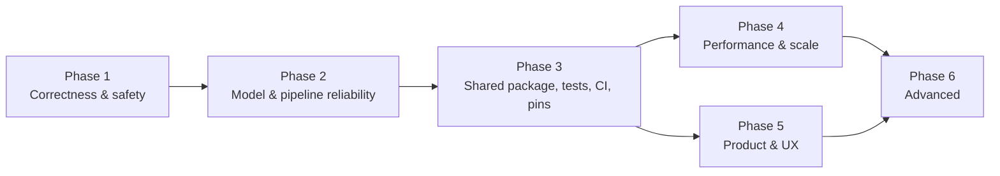

# EDUPRO — Improvement Roadmap

**Companion to:** `audit/EDUPRO_AUDIT_REPORT.md`  
**Audit date:** 2026-10-28  
**Scope:** actionable, dependency-aware plan for EDUPRO. No deadlines are assigned. Effort is relative (S/M/L), not a calendar estimate.

---

## How to read this roadmap

- **Priority:** P0 (critical security/data-loss/system-breaking), P1 (high-impact correctness/security), P2 (important reliability/maintainability/performance/UX), P3 (optional/long-term). The audit found no confirmed P0.
- **Effort:** S = hours to a day for one engineer familiar with the code; M = a few days; L = one to several weeks including data/model validation.
- **Finding IDs** refer to `audit/EDUPRO_AUDIT_REPORT.md`.
- Tasks are ordered by dependency and risk reduction, not by arbitrary dates.
- Every task includes acceptance criteria and validation tests. A task is not complete until its validation tests pass in CI.

### Guiding principles

1. **Fix correctness before scale.** Do not add features on top of a revenue model that is an identity.
2. **One feature pipeline.** Training, evaluation, and inference must use the same transformation code.
3. **Data-derived facts.** Reports and dashboard copy must be generated or asserted from the data.
4. **No silent failures.** Missing artifacts, schema changes, and forecast fallbacks must be visible.
5. **Evolve, don't rewrite.** The batch + Streamlit shape is appropriate for this project.

---

## Phase 1 — Critical Bugs and Security

Goal: stop user-visible incorrectness and prevent unsafe deployment. These tasks are small enough to start immediately and reduce the most trust-damaging defects.

### R1.1 — Fix price/duration binning and out-of-range crashes

| Field | Detail |
|---|---|
| Priority | P1 |
| Findings | F-04, F-03 |
| Rationale | The form accepts a price of 500, and the sensitivity curve can test up to price+100. `np.digitize(...)-1` indexes a five-element list and raises `IndexError` at 500. Boundary values also disagree with training. |
| Affected files | `app/utils.py` (`_build_input_row`, `predict_revenue`, `predict_enrollment`), `app/app.py` (price input and sensitivity loop), `notebooks/03_feature_engineering.py` (bin definitions) |
| Prerequisites | None |
| Effort | S |
| Acceptance criteria | Price 0, 50, 100, 200, 500, and >500 never crash; feature values match training for all boundary values; out-of-range input produces a clear validation message; sensitivity range is bounded to the validated domain. |
| Validation tests | Unit test table of price/duration boundaries; property test that the input builder never raises for the declared widget bounds; Streamlit AppTest submitting price 500 and 400. |

### R1.2 — Make inference honor every form input

| Field | Detail |
|---|---|
| Priority | P1 |
| Findings | F-03 |
| Rationale | `course_type`, `course_rating`, and `payment_method` are collected but never passed. `_build_input_row` silently defaults to Paid/4.0/Credit Card and hardcodes `ExpertiseCategoryMatch=1`. Predictions therefore do not reflect user choices and differ from training distributions. |
| Affected files | `app/app.py:190-215`, `app/utils.py:201-287` |
| Prerequisites | R1.1 (shared input builder) |
| Effort | M |
| Acceptance criteria | Changing any form field that has a learned relationship changes the prediction or is explicitly documented as ignored; no silent defaults remain; the function signature and UI are aligned; the prediction response includes the exact feature row used (for audit/debug). |
| Validation tests | Unit tests that vary each input one at a time; a parity test comparing `_build_input_row` output to the training feature row for a known course; a test that `course_type='Free'` uses Free encoding. |

### R1.3 — Remove or replace the "optimal price" recommendation

| Field | Detail |
|---|---|
| Priority | P1 |
| Findings | F-02 |
| Rationale | The sensitivity chart uses only the revenue identity, so predicted revenue rises with price and `idxmax()` always picks the highest tested price. This is a harmful recommendation, not an optimization. Until a demand-response model exists, the UI must not claim an optimum. |
| Affected files | `app/app.py:229-247`, `app/utils.py:260-272`, optionally `notebooks/04_model_training.py` |
| Prerequisites | R1.1; R1.4 or R2.1 for a real demand curve |
| Effort | M |
| Acceptance criteria | The page no longer labels a price as "optimal" based on the current model; the chart is clearly labeled as a scenario/sensitivity of predicted transaction amount, or is removed; if a demand model is added, expected revenue uses `price × predicted_demand(price)` and includes uncertainty. |
| Validation tests | Snapshot test that the UI does not emit "optimal price"; unit test that expected-revenue calculation uses both price and demand; review of displayed copy. |

### R1.4 — Redefine the revenue target and remove target leakage

| Field | Detail |
|---|---|
| Priority | P1 |
| Findings | F-01 |
| Rationale | `Amount` equals `CoursePrice` for every paid row and 0 for every free row (r = 1.0). The revenue model is an identity. It cannot support revenue forecasting, pricing, or ROI claims. |
| Affected files | `notebooks/03_feature_engineering.py`, `notebooks/04_model_training.py:184-217`, `notebooks/05_model_evaluation.py:136-186`, `models/revenue_model.pkl`, `app/utils.py:260-272` |
| Prerequisites | Product decision on unit of analysis and horizon (transaction, course-month, or future period) |
| Effort | L |
| Acceptance criteria | Documented target definition with a time horizon; no feature is a deterministic function of the target; a naive/seasonal baseline is reported; temporal or grouped holdout is used; the dashboard labels the output in the correct unit/horizon; model metadata records the target definition. |
| Validation tests | Leakage test (correlation/identity checks, feature-target timestamp assertions); baseline comparison test; holdout-only final metric; regression test that a free course does not receive a positive revenue prediction unless explicitly modeled. |

### R1.5 — Correct the README and static reports from data

| Field | Detail |
|---|---|
| Priority | P1 |
| Findings | F-06, F-20 |
| Rationale | The docs claim 50% free (actual 64.03%), top categories AI/ML/DS (actual AI/Business/Project Management), and ML/DS leadership (ML revenue $133.38, Marketing $0). They also call the demo "production-ready". |
| Affected files | `README.md`, `reports/executive_summary.md`, `reports/research_paper.md`, optionally a new `reports/facts.json` generated by the pipeline |
| Prerequisites | R2.10 (data-quality rules) for stable facts |
| Effort | M |
| Acceptance criteria | Every numeric business claim in the docs is either generated from `processed_data.csv` or accompanied by a reproducible command; free/paid, category, and readiness statements are corrected; forecast claims are labeled as model output subject to backtesting; "production-ready" is replaced with an explicit status. |
| Validation tests | A `test_report_facts` that recomputes the headline facts and compares to generated values; a documentation link check. |

### R1.6 — Make the dashboard fail safely on missing artifacts

| Field | Detail |
|---|---|
| Priority | P2 (do early; it protects first-run users) |
| Findings | F-11 |
| Rationale | The app reads the CSV at startup with no existence check. A user who launches the dashboard before the pipeline sees a traceback. |
| Affected files | `app/app.py:89-97,348-349`, `app/utils.py:44-47` |
| Prerequisites | None |
| Effort | S |
| Acceptance criteria | Missing CSV/model/forecast produces a friendly `st.error` with the exact pipeline command; available pages still render; no stack trace is shown to the user. |
| Validation tests | AppTest with a temporary directory missing each artifact; assert the error text and no exception. |

### R1.7 — Decide and document the privacy/security posture

| Field | Detail |
|---|---|
| Priority | P1 if real data or public deployment; P2 now |
| Findings | F-18, F-22 |
| Rationale | The raw workbook contains 3,000 unique emails and user names. The app has no auth. If either the synthetic claim or the local-only assumption is wrong, the exposure is high. |
| Affected files | `data/EduPro_Online_Platform.xlsx`, `README.md`, `.gitignore` (new), deployment docs (new) |
| Prerequisites | Confirmation from the owner that the data is synthetic and the app is local-only |
| Effort | S |
| Acceptance criteria | Written data classification and deployment assumption; raw data removed from version control or explicitly marked synthetic; app behind auth if shared; no PII in generated reports; data-handling note in README. |
| Validation tests | Secret/PII scan in CI; review checklist; auth smoke test if deployed. |

---

## Phase 2 — Reliability and Correctness

Goal: make the models defensible and the pipeline predictable.

### R2.1 — Reframe the enrollment demand target

| Field | Detail |
|---|---|
| Priority | P1 |
| Findings | F-05 |
| Rationale | The current target is a 60-row, near-uniform course total (140–196, CV 7.5%), and the model R² is near zero. The UI still shows a point estimate. |
| Affected files | `notebooks/04_model_training.py:63-181`, `notebooks/03_feature_engineering.py`, `app/utils.py:275-287`, `app/app.py:214-227` |
| Prerequisites | R2.2 (stable course/teacher entity); product decision on horizon |
| Effort | L |
| Acceptance criteria | A target with actionable variance and an explicit time horizon; grouped/temporal CV; mean/naive baseline; prediction intervals; UI labels "estimate" with uncertainty and hides or downgrades predictions when the model does not beat baseline. |
| Validation tests | Baseline comparison; interval coverage test on holdout; test that a low-signal model triggers the "insufficient signal" UI state. |

### R2.2 — Define a stable course–teacher data model

| Field | Detail |
|---|---|
| Priority | P1 |
| Findings | F-08 |
| Rationale | Every course has 7–30 teachers. `first`/median aggregation makes teacher features row-order dependent and semantically invalid. |
| Affected files | `notebooks/01_data_preprocessing.py`, `notebooks/03_feature_engineering.py`, `notebooks/04_model_training.py:65-86`, `data/processed_data.csv` schema |
| Prerequisites | Business decision: is a course taught by one primary instructor, a pool, or per-transaction instructors? |
| Effort | M |
| Acceptance criteria | Documented definition of the teacher relationship; deterministic aggregation (or transaction-level modeling); no `first`/median on arbitrary transaction fields for course-level features; teacher features reproducible regardless of row order. |
| Validation tests | Shuffle input rows and assert identical course-level features; test the teacher aggregation on a fixture with multiple teachers. |

### R2.3 — Fix model selection and evaluation protocol

| Field | Detail |
|---|---|
| Priority | P1 |
| Findings | F-07 |
| Rationale | The test set is used to choose the best model and to compare tuned XGBoost, then reported as final. `cross_val_score` is unused. |
| Affected files | `notebooks/04_model_training.py:112-148,151-217`, `notebooks/05_model_evaluation.py:136-193` |
| Prerequisites | R1.4/R2.1 target definitions |
| Effort | M |
| Acceptance criteria | Train/validation/test or nested CV; selection/tuning on validation only; one final test evaluation; mean ± std across folds; metrics persisted with the model; test-set reuse is prohibited by code structure or documented guard. |
| Validation tests | Unit test asserting the selection function never receives the test set; a metric artifact test; a regression test that the reported metric equals the persisted metric. |

### R2.4 — Make historical features point-in-time

| Field | Detail |
|---|---|
| Priority | P2 |
| Findings | F-10 |
| Rationale | `EnrollmentCount`, `TotalRevenue`, `AverageRevenue`, `RevenuePerEnrollment`, `MonthlyRevenue`, `RollingRevenueAverage`, and `RevenueGrowthRate` are computed over the full history and would leak if used. They are already described as features in the docs. |
| Affected files | `notebooks/03_feature_engineering.py:120-154`, `README.md:80-84`, `reports/research_paper.md:130-138` |
| Prerequisites | A prediction timestamp/horizon |
| Effort | M |
| Acceptance criteria | Each feature has an explicit as-of timestamp; expanding/rolling windows use only prior data; analysis-only columns are named or documented as non-features; leakage tests pass. |
| Validation tests | For each row, assert all feature dates <= prediction cutoff; add a synthetic future-leak fixture that must fail validation. |

### R2.5 — Make feature engineering idempotent and path-safe

| Field | Detail |
|---|---|
| Priority | P2 |
| Findings | F-12 |
| Rationale | Step 03 reads and writes the same CSV and merges columns that may already exist, producing `_x/_y` suffixes on repeated runs. |
| Affected files | `notebooks/03_feature_engineering.py:16-17,120-154`, `run_pipeline.py` |
| Prerequisites | None |
| Effort | M |
| Acceptance criteria | Running step 03 twice produces identical schema and values; input and output paths are separate; writes are atomic (temp + rename); pipeline reruns are safe. |
| Validation tests | Idempotency test that runs the step twice on a temporary copy and compares hashes; schema snapshot test. |

### R2.6 — Add schema and data-quality contracts

| Field | Detail |
|---|---|
| Priority | P2 |
| Findings | F-13, F-20 |
| Rationale | Excel sheet/column changes cause `KeyError` or silent column drops. Anomalies such as a $0.78 paid course and a zero-revenue category flow into reports. |
| Affected files | `notebooks/01_data_preprocessing.py:26-85`, new `edup/schema.py`, `notebooks/04_model_training.py:160-161,192-193`, `app/utils.py:44-47` |
| Prerequisites | R2.2 (teacher model) |
| Effort | M |
| Acceptance criteria | Required sheets/columns/dtypes/ranges/unique keys/allowed categories are validated before use; human-readable errors; anomalies are reported in a quality table; the pipeline fails fast on contract violations. |
| Validation tests | Fixtures for missing sheet/column, wrong dtype, negative price, paid price below threshold, duplicate course name; assert expected failure/anomaly record. |

### R2.7 — Replace broad exception handling and global warning suppression

| Field | Detail |
|---|---|
| Priority | P2 |
| Findings | F-14 |
| Rationale | Any Prophet/data error becomes "Prophet unavailable"; the ARIMA fallback does not save results; all warnings are hidden. |
| Affected files | `notebooks/06_forecasting.py:141-180`, `app/app.py:12,363,430`, `app/utils.py:12,303`, `notebooks/05_model_evaluation.py:84` |
| Prerequisites | Logging setup (R3.3) |
| Effort | S/M |
| Acceptance criteria | Specific exception types; full context logged; forecast result/status always persisted; UI shows the source and error; warnings filtered only where documented. |
| Validation tests | Inject an `ImportError` and a data error separately; assert different handling and persisted status; assert no global warning filter. |

### R2.8 — Add forecast backtesting and baselines

| Field | Detail |
|---|---|
| Priority | P2 |
| Findings | F-16 |
| Rationale | Twelve monthly points with yearly seasonality, no holdout, no baseline, and no metrics. The enrollment forecast is computed but not shown. |
| Affected files | `notebooks/06_forecasting.py:29-86,141-180`, `app/app.py:261-289`, new `edup/forecasting/backtest.py` |
| Prerequisites | More history for credible seasonality; otherwise disable yearly seasonality |
| Effort | M/L |
| Acceptance criteria | Rolling-origin backtest, seasonal-naive baseline, MAE/MAPE per horizon, persisted metrics, minimum-history guard, backtest chart, enrollment forecast displayed or claim removed. |
| Validation tests | Backtest on a fixture with known seasonality; assert metrics are persisted and displayed; test behavior with <24 months. |

### R2.9 — Fix explainability for the actual saved models

| Field | Detail |
|---|---|
| Priority | P2 |
| Findings | F-09 |
| Rationale | The default revenue model is `LinearRegression`; the page expects `feature_importances_` and `TreeExplainer`. |
| Affected files | `app/app.py:324-435`, `app/utils.py:292-311` |
| Prerequisites | R1.4 (revenue model may change) |
| Effort | M |
| Acceptance criteria | Model-aware explainer selection; permutation importance fallback; no dead SHAP button; clear message if a model cannot be explained; both model tabs render without error. |
| Validation tests | AppTest for each model selection; unit test for explainer selection; fixture with a linear model and a tree model. |

### R2.10 — Validate and surface data anomalies

| Field | Detail |
|---|---|
| Priority | P2 |
| Findings | F-20 |
| Rationale | The $0.78 paid course and all-free Marketing category distort category analytics and reports. |
| Affected files | `notebooks/01_data_preprocessing.py:88-107`, new quality report, `reports/*` |
| Prerequisites | R2.6 |
| Effort | M |
| Acceptance criteria | Quality rules flag paid price thresholds, paid/free consistency, duplicate course names, zero-revenue categories; anomalies appear in a visible report; the known synthetic artifacts are documented. |
| Validation tests | Fixture tests for each rule; report snapshot; test that anomalies do not silently disappear. |

---

## Phase 3 — Architecture and Code Quality

Goal: remove the conditions that create the Phase 1/2 bugs.

### R3.1 — Create a shared package and configuration

| Field | Detail |
|---|---|
| Priority | P2 |
| Findings | F-21 |
| Rationale | Feature lists, bins, paths, and constants are duplicated across training, evaluation, app, and utils. |
| Affected files | New `src/edup/config.py`, `src/edup/features/`, `src/edup/data/`; update all scripts and `app/` |
| Prerequisites | R1.2/R1.4 definitions stabilized |
| Effort | M |
| Acceptance criteria | One source of truth for paths, categories, feature lists, and transforms; training and inference import the same code; no `sys.path` hacks; tests import the package normally. |
| Validation tests | Parity test: training and inference produce identical feature matrices for the same input; import smoke test. |

### R3.2 — Delete dead code and fix documentation drift

| Field | Detail |
|---|---|
| Priority | P2 |
| Findings | F-21 |
| Rationale | `get_kpis` is unused, `chart_course_level_comparison` is unused, `top10` is unused, constants are unused, `preprocessing_pipeline.pkl` is unused, and docs do not distinguish the 22-column merged stage from the 44-column processed artifact and incorrectly call the matrix sparse. |
| Affected files | `app/app.py:94-97`, `app/utils.py:35-39,142-157,166`, `notebooks/04_model_training.py:213-215`, `README.md`, `reports/research_paper.md` |
| Prerequisites | R3.1 |
| Effort | S |
| Acceptance criteria | No unused public helpers/constants/artifacts; docs match the current schema and encoding; `preprocessing_pipeline.pkl` is either used or removed. |
| Validation tests | Static dead-code check in CI (e.g., vulture/ruff); documentation fact tests. |

### R3.3 — Add type hints, linting, logging, and error taxonomy

| Field | Detail |
|---|---|
| Priority | P2 |
| Findings | F-14, F-21, F-23 |
| Rationale | No type safety, no structured logs, broad exceptions. |
| Affected files | all `.py`; new `edup/logging.py`, `pyproject.toml` config |
| Prerequisites | R3.1 |
| Effort | M |
| Acceptance criteria | Public functions typed; ruff/black/isort/mypy configured; structured logs with levels and context; exception classes for data/model/forecast errors; no global warning suppression. |
| Validation tests | Lint/type check in CI; log-capture unit tests. |

### R3.4 — Add tests and CI

| Field | Detail |
|---|---|
| Priority | P1/P2 (highest-leverage reliability task) |
| Findings | F-23 |
| Rationale | There are no tests. Every confirmed bug is testable. |
| Affected files | new `tests/`, `.github/workflows/ci.yml`, `pyproject.toml` |
| Prerequisites | R3.1; R3.5 (pinned deps) |
| Effort | L |
| Acceptance criteria | Unit + integration + Streamlit AppTest suites run in CI; pipeline smoke test on a small fixture; coverage report; CI fails on lint/type/test failure. See `audit/EDUPRO_TESTING_PLAN.md`. |
| Validation tests | CI run on a clean checkout; intentionally broken fixture must fail. |

### R3.5 — Pin dependencies and add model metadata

| Field | Detail |
|---|---|
| Priority | P2 |
| Findings | F-17 |
| Rationale | Lower-bound-only requirements and opaque pickles make rebuilds and artifact loading unreliable. |
| Affected files | `requirements.txt`, `app/requirements.txt`, new `pyproject.toml`, `requirements.lock`, `models/model_metadata.json` |
| Prerequisites | None |
| Effort | M |
| Acceptance criteria | Exact versions locked; Python version declared; model metadata includes training date, data hash, row count, feature list, library versions, metrics, and Git commit; CI rebuilds and loads the model. |
| Validation tests | Fresh-environment install + model load test; metadata schema test; checksum verification. |

### R3.6 — Repository hygiene and packaging

| Field | Detail |
|---|---|
| Priority | P3 |
| Findings | F-26 |
| Rationale | Zone.Identifier files, bytecode present in the tree, no `.gitignore`, no LICENSE, data/models mixed with source. |
| Affected files | repository root |
| Prerequisites | None |
| Effort | S |
| Acceptance criteria | `.gitignore`, LICENSE, clean tree, separated `data/`, `artifacts/`, `src/`, `tests/`; no OS metadata or bytecode. |
| Validation tests | CI check for forbidden file patterns. |

---

## Phase 4 — Performance and Scalability

Goal: improve responsiveness and prepare for larger data without premature complexity.

### R4.1 — Cache models and batch predictions

| Field | Detail |
|---|---|
| Priority | P2 |
| Findings | F-15 |
| Rationale | The revenue model is deserialized 21 times per form submit. |
| Affected files | `app/utils.py:260-287`, `app/app.py:230-234` |
| Prerequisites | R1.1 |
| Effort | S |
| Acceptance criteria | Models loaded once per process via `st.cache_resource`; sensitivity predictions batched; page latency measured before/after. |
| Validation tests | Unit test that the loader is called once; benchmark script. |

### R4.2 — Cache expensive dashboard computations

| Field | Detail |
|---|---|
| Priority | P3 |
| Findings | F-15 |
| Rationale | Charts/KPIs recompute on every Streamlit rerun. |
| Affected files | `app/app.py`, `app/utils.py` |
| Prerequisites | R4.1 |
| Effort | S |
| Acceptance criteria | KPI/chart functions cached by data hash; stale cache invalidated when the CSV changes; no behavior change. |
| Validation tests | AppTest rerun; benchmark. |

### R4.3 — Move serving data to Parquet/DuckDB (when justified)

| Field | Detail |
|---|---|
| Priority | P3 |
| Findings | Architecture |
| Rationale | CSV full-file scans will not scale; typed columnar storage improves performance and schema enforcement. |
| Affected files | `edup/data/`, `app/utils.py` |
| Prerequisites | Data volume growth or multi-user usage; R3.1 |
| Effort | M |
| Acceptance criteria | Same query results as CSV; faster cold load; schema preserved; fallback to CSV for development. |
| Validation tests | Equivalence tests between CSV and Parquet results; benchmark. |

### R4.4 — Add an optional prediction API

| Field | Detail |
|---|---|
| Priority | P3 |
| Findings | Architecture |
| Rationale | Non-Streamlit consumers, auth, rate limits, and batch scoring need an API. |
| Affected files | new `edup/api/` |
| Prerequisites | R1.4/R2.1; R3.5; auth decision |
| Effort | M/L |
| Acceptance criteria | Versioned endpoint; schema validation; model metadata; auth; latency/error metrics; OpenAPI docs. |
| Validation tests | Contract tests; load test; auth tests. |

### R4.5 — Scheduled retraining and model registry

| Field | Detail |
|---|---|
| Priority | P3 |
| Findings | F-17, F-16 |
| Rationale | Manual retraining and opaque artifacts prevent safe iteration. |
| Affected files | new orchestration/registry config |
| Prerequisites | R3.4, R3.5 |
| Effort | L |
| Acceptance criteria | Scheduled/triggered retrain; metrics comparison; promotion/rollback; data hash and version recorded. |
| Validation tests | Dry-run retrain; rollback test; registry metadata test. |

### R4.6 — Add monitoring and observability

| Field | Detail |
|---|---|
| Priority | P2 if deployed; P3 now |
| Findings | F-23 |
| Rationale | No logs/metrics/drift detection. |
| Affected files | app/API/pipeline instrumentation |
| Prerequisites | R3.3, R4.4 |
| Effort | M |
| Acceptance criteria | Error tracking; request/latency metrics; data drift and prediction distribution monitoring; alert thresholds; runbook. |
| Validation tests | Synthetic drift fixture triggers an alert; error injection is recorded. |

---

## Phase 5 — Product and UX Improvements

Goal: turn the repaired analytics into a trustworthy decision-support product.

### R5.1 — Show uncertainty everywhere a prediction is shown

| Field | Detail |
|---|---|
| Priority | P1 for trust (can follow Phase 2) |
| Findings | F-05, F-16 |
| Rationale | Point estimates imply false precision. |
| Affected files | `app/app.py:214-247,261-289`, model/forecast code |
| Prerequisites | R2.1, R2.8 |
| Effort | M |
| Acceptance criteria | Prediction intervals for demand; Prophet intervals already available; clear "estimate" language; no interval = no point estimate. |
| Validation tests | Interval coverage on holdout; UI snapshot. |

### R5.2 — Add scenario planning instead of a single forecast

| Field | Detail |
|---|---|
| Priority | P2 |
| Findings | F-16, F-02 |
| Rationale | Leadership needs base/optimistic/pessimistic views with assumptions, not one number. |
| Affected files | forecasting + app |
| Prerequisites | R2.8 |
| Effort | M |
| Acceptance criteria | Three scenarios with explicit assumptions; comparison table/chart; assumptions visible; exportable. |
| Validation tests | Scenario math tests; UI test. |

### R5.3 — Generate reports from data

| Field | Detail |
|---|---|
| Priority | P1/P2 |
| Findings | F-06 |
| Rationale | Hand-written reports are already stale. |
| Affected files | new `edup/reporting/generate.py`, `reports/*.md` templates |
| Prerequisites | R2.10 |
| Effort | M |
| Acceptance criteria | Exec summary facts/tables generated at pipeline time; assertions for expected ranges; reports include data hash/date; no hand-edited numbers. |
| Validation tests | Fact-regeneration test; snapshot diff. |

### R5.4 — Add a data-quality and category health panel

| Field | Detail |
|---|---|
| Priority | P2 |
| Findings | F-20, F-19 |
| Rationale | Users need to see anomalies and category health, not just revenue. |
| Affected files | `app/app.py`, `app/utils.py` |
| Prerequisites | R2.10 |
| Effort | M |
| Acceptance criteria | Data-quality flags visible; category scorecard includes revenue, paid conversion, enrollments, rating, teacher supply, anomaly status; no "profit" label without costs. |
| Validation tests | UI test with fixture anomalies; math tests. |

### R5.5 — Improve labeling, accessibility, and exports

| Field | Detail |
|---|---|
| Priority | P3 |
| Findings | F-19, F-27 |
| Rationale | Misleading labels and color-only charts reduce usability. |
| Affected files | app pages |
| Prerequisites | None |
| Effort | S/M |
| Acceptance criteria | "Revenue efficiency" instead of "profitability"; explicit time horizons; accessible chart labels; CSV export for tables; date/category filters. |
| Validation tests | Copy snapshot; accessibility checklist; export test. |

### R5.6 — Add onboarding and actionable error states

| Field | Detail |
|---|---|
| Priority | P3 |
| Findings | F-11 |
| Rationale | First-run experience should guide the user, not crash. |
| Affected files | `app/app.py` |
| Prerequisites | R1.6 |
| Effort | S |
| Acceptance criteria | Onboarding explains pipeline prerequisite; page-level errors include commands; empty states are clear. |
| Validation tests | AppTest missing-artifact states. |

---

## Phase 6 — Advanced Features and Long-Term Improvements

These are only justified after Phases 1–3. Do not build them on top of an invalid revenue model.

### R6.1 — User-level churn/retention

- **Priority:** P3
- **Rationale:** High business value, but the current dataset has no engagement/completion history. Requires new data.
- **Prerequisites:** Event/session/completion data; privacy review.
- **Effort:** L
- **Acceptance:** Defined churn label, temporal validation, calibration, fairness review.
- **Validation:** Backtest on future cohorts; churn precision/recall.

### R6.2 — NLP course-quality signals

- **Priority:** P3
- **Rationale:** The current data has no review text; the research paper lists this as future work.
- **Prerequisites:** Review/description corpus; labeling.
- **Effort:** L
- **Acceptance:** Documented text features, leakage-free split, human evaluation.

### R6.3 — Dynamic pricing / experimentation

- **Priority:** P3
- **Rationale:** The current "optimal price" is invalid. Real dynamic pricing needs demand experiments and causal identification.
- **Prerequisites:** F-02/R5.2; A/B testing infrastructure; logged interventions.
- **Effort:** L
- **Acceptance:** Uplift measured in a controlled experiment; guardrails; rollback.

### R6.4 — Real-time ingestion and inference

- **Priority:** P3
- **Rationale:** The current pipeline is batch. Real-time is only valuable with live transactions.
- **Prerequisites:** Event stream, API, auth, monitoring.
- **Effort:** L
- **Acceptance:** Freshness SLO, schema validation, latency SLO, failure recovery.

### R6.5 — MLOps maturity

- **Priority:** P3
- **Rationale:** Model registry, retraining, drift detection, and rollback are long-term investments.
- **Prerequisites:** R3.5, R3.4, R4.5, R4.6.
- **Effort:** L
- **Acceptance:** Reproducible training, automated promotion gates, rollback, model cards, audit trail.

---

## Sequencing and dependencies

- Do **R1.1–R1.3** immediately; they are small and directly user-visible.
- Start **R1.4/R2.1/R2.2/R2.3** as a single workstream; target definition, unit of analysis, and evaluation protocol must be decided together.
- Start **R3.4/R3.5** early even though they sit in Phase 3; tests and pinned dependencies protect everything else.
- Do **not** build R6.3 (dynamic pricing) before R1.4/R1.5 and a real demand model.

## What not to do yet

- Do not add a database, API, or MLflow just because they are "production" keywords. The data and usage do not yet justify them.
- Do not add deep learning, NLP, or reinforcement learning on 10k synthetic transactions.
- Do not add more dashboard pages before the existing pages are correct.
- Do not tune hyperparameters further to chase R²; the target and evaluation are the problem, not the search grid.
- Do not claim an ROI percentage without a causal design and a documented baseline.

## Definition of done for the roadmap

The improvement program is successful when:

1. A user can explain what every number on every page means, in which unit, and over what horizon.
2. The revenue model is not a restatement of price, and the demand model beats a documented baseline (or the UI says it does not).
3. Training and inference use the same feature code and pass parity tests.
4. Reports are generated from the current data and cannot silently drift.
5. The pipeline is reproducible from a clean environment and covered by CI.
6. A missing artifact or failed forecast produces a clear, actionable message.
7. If deployed beyond localhost, access is authenticated and audited.

Acceptance criteria and validation tests for each task are listed above; the cross-cutting test strategy is in `audit/EDUPRO_TESTING_PLAN.md`.
